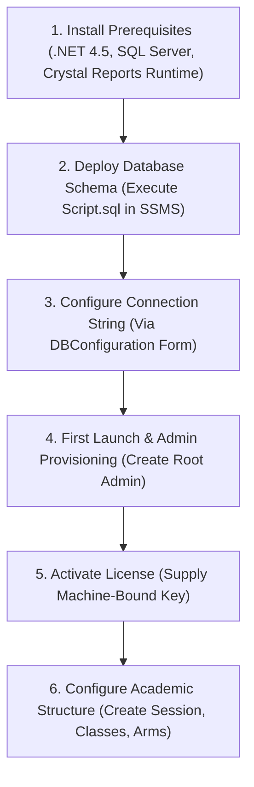

# Cash Desk Application - Technical & Operational Documentation

> **System Name:** Cash Desk (CashDeskApp)  
> **Target Framework:** .NET Framework 4.5 (C# / Windows Forms)  
> **Database Engine:** Microsoft SQL Server 2012+ / SQL Express (`Cashdesh_bosss_sysdb`)  
> **Reporting Engine:** SAP Crystal Reports for Visual Studio (v13.x) & iTextSharp  
> **UI Components:** Windows Forms, Bunifu UI, MetroFramework, LiveCharts (WinForms/WPF), Zen Barcode  
> **Document Version:** 1.0.0  

---

## Table of Contents
1. [Executive Summary](#1-executive-summary)
2. [System Architecture & Design Patterns](#2-system-architecture--design-patterns)
3. [Technology Stack & Dependencies](#3-technology-stack--dependencies)
4. [Database Design & Schema Analysis](#4-database-design--schema-analysis)
5. [Core Modules & Functional Breakdown](#5-core-modules--functional-breakdown)
   - [5.1 Authentication, Access Control & Audit Logging](#51-authentication-access-control--audit-logging)
   - [5.2 Academic Structure & Student Lifecycle Management](#52-academic-structure--student-lifecycle-management)
   - [5.3 Fee Billing, Installments & Bank Teller Reconciliation](#53-fee-billing-installments--bank-teller-reconciliation)
   - [5.4 Background Debt Computation Engine (GroundWorker)](#54-background-debt-computation-engine-groundworker)
   - [5.5 Student Digital Wallet & Pocket Money System](#55-student-digital-wallet--pocket-money-system)
   - [5.6 Point of Sale (POS) & Store Inventory Subsystem](#56-point-of-sale-pos--store-inventory-subsystem)
   - [5.7 Event & Dues Management](#57-event--dues-management)
   - [5.8 Expenditure & Operational Expense Accounting](#58-expenditure--operational-expense-accounting)
   - [5.9 Crystal Reports & Receipt Printing](#59-crystal-reports--receipt-printing)
   - [5.10 Machine Licensing & Hardware Activation](#510-machine-licensing--hardware-activation)
   - [5.11 Database Setup, Backup & Recovery Engine](#511-database-setup-backup--recovery-engine)
6. [Repository & Codebase Organization](#6-repository--codebase-organization)
7. [Installation & Deployment Guide](#7-installation--deployment-guide)
8. [Troubleshooting & Maintenance Manual](#8-troubleshooting--maintenance-manual)

---

## 1. Executive Summary

**Cash Desk** is an enterprise-grade Windows desktop financial management and accounting suite tailored for primary and secondary educational institutions. The application unifies all critical bursary and campus commerce operations into a single coordinated system:

- **Bursary Operations:** Automated student fee scheduling, multi-term installments, bank teller voucher tracking, and real-time debt calculation.
- **Campus Commerce (Store / Tuck Shop):** Barcode-enabled Point of Sale (POS), item inventory tracking, vendor reordering, customer profiles, and credit sales.
- **Student Digital Wallet (Pocket Money):** Cashless student spending accounts, supporting bulk parent funding, transaction ledgers, and cashless campus purchases.
- **Operational Accounting:** Hierarchical expenditure approvals, multi-code budget categorization, and daily cash reconciliation.
- **Auditing & Reporting:** Over 15 built-in Crystal Reports, thermal POS slip generation, A4 receipt vouchers, and real-time interactive analytical dashboards.

---

## 2. System Architecture & Design Patterns

The solution is organized using a layered, decoupled design combining classic WinForms event-driven architecture with modern Service/Factory patterns and asynchronous background processing.

```
+-----------------------------------------------------------------------+
|                         PRESENTATION LAYER                            |
|  - Main Dashboard (DashBoardFrm)  - POS & Inventory (DashboardFrm)    |
|  - Student & Fee Forms            - LiveCharts (WPF/WinForms)         |
|  - Metro & Bunifu Custom Controls - Zen Barcode 1D / 2D Renderers     |
+-----------------------------------------------------------------------+
                                   |
                                   v
+-----------------------------------------------------------------------+
|                    APPLICATION & DOMAIN SERVICE LAYER                 |
|  - Factory Pattern (Factory.cs)                                       |
|  - Domain Entities: Student, Transaction, Customer, Stock, Expenses  |
|  - GroundWorker & GroundworkerFulPay (Multi-threaded async sync)      |
|  - License & Activation Gatekeepers (AppActivation, HardWareID)       |
+-----------------------------------------------------------------------+
                                   |
                                   v
+-----------------------------------------------------------------------+
|                         DATA ACCESS LAYER                             |
|  - ADO.NET (SqlHelper, SqlCommand, SqlDataAdapter, SqlConnection)    |
|  - Dynamic Encrypted Connection Management (StringEncryptor)          |
|  - Stored Procedures & Transaction Control (ACID semantics)           |
+-----------------------------------------------------------------------+
                                   |
                                   v
+-----------------------------------------------------------------------+
|                         PERSISTENCE ENGINE                            |
|  - Microsoft SQL Server 2012+ (Database: Cashdesh_bosss_sysdb)        |
|  - Windows Isolated Storage (apps.txt activation file)                |
|  - System File I/O (Database backups, Barcodes, Excel Imports)        |
+-----------------------------------------------------------------------+
```

### Key Architectural Characteristics
1. **Factory Pattern (`Factory.cs`):** Centralizes object lifecycle creation for core models (`Student`, `Transaction`, `Receipt`, `Expenses`, `UserSettings`, `SqlHelper`), minimizing tight coupling between UI forms and underlying data adapters.
2. **Domain Model Inheritance:** `Customer` serves as the foundational patron model. `Student` inherits from `Customer` (adding school attributes: registration numbers, session IDs, class assignments, and arms). `Transaction` inherits from `Student`, unifying student identity with personal wallet ledger operations.
3. **Multi-Threaded Background Processing:** Heavy financial reconciliations—such as term-by-term debt audits and zero-payment student scans—are executed off the main UI thread via `Task.Run()` and background threads in `GroundWorker.cs`, ensuring high UI responsiveness during application launch.
4. **Dual Data Access Strategy:** Combines parameterized direct ADO.NET queries for lightweight form searches with over 90 compiled SQL Server stored procedures for critical multi-table transactions (fee payments, wallet funding, inventory checkout).

---

## 3. Technology Stack & Dependencies

### Core Frameworks
- **Platform:** Microsoft .NET Framework 4.5
- **Language:** C# 5.0 / 6.0 compatible
- **Database Engine:** Microsoft SQL Server 2012, 2014, 2016, 2019, 2022 / Express

### Third-Party Libraries & NuGet Packages
| Package Name | Version | Role / Purpose |
| :--- | :--- | :--- |
| `CrystalDecisions.CrystalReports.Engine` | 13.0.x | Core enterprise document reporting and preview engine |
| `LiveCharts.WinForms` / `LiveCharts.Wpf` | 0.9.7.1 | Interactive visualization, charts, and metrics dashboard |
| `ExcelDataReader` / `DataSet` | 3.6.0 | High-performance binary parser for `.xlsx` and `.xls` student rosters |
| `Zen.Barcode.Rendering.Framework` | 3.1.10729.1 | Code128 1D barcodes and QR Code 2D matrix generator |
| `CircularProgressBar` / `WinFormAnimation` | 2.8.0.16 | Fluid animated circular progress indicators |
| `Bunifu.Core` / `Bunifu_UI_v1.5.3` | 1.8.0.1 | Modernized UI button, card, and flat control skinning |
| `MetroFramework` | Legacy | Clean Windows 8/10 styled container controls |
| `iTextSharp` | Legacy | Programmatic PDF document and receipt generation |
| `System.Text.Json` | 9.0.4 | Modern high-throughput serialization support |
| `EncryptString` / `Secure` / `AesEncrypt` | In-house DLLs | AES/TripleDES encryption for passwords and connection strings |

---

## 4. Database Design & Schema Analysis

The system relies on Microsoft SQL Server (`Cashdesh_bosss_sysdb`). The database schema is initialized and maintained through `Script.sql` and `cashdesk_empty_script.sql`.

```mermaid
erDiagram
    ADMIN ||--o{ ADMINLOG : records
    ADMIN ||--o{ STOCKCATEGORY : creates
    ADMIN ||--o{ CUSTOMER : registers
    
    SESSION ||--o{ CLASS : contains
    CLASS ||--o{ NAMES : groups
    NAMES ||--|| WALLET : owns
    WALLET ||--o{ TRANSACTIONS : logs
    
    NAMES ||--o{ FEES : billed
    FEES ||--o{ FIRSTTERM : splits
    FEES ||--o{ SECONDTERM : splits
    FEES ||--o{ THIRDTERM : splits
    FEES ||--o{ REGULARPAYMENT : pays
    FEES ||--o{ TALLER : verifies
    
    CUSTOMER ||--o{ INVOICE : purchases
    INVOICE ||--o{ SOLDSTOCK : contains
    INVOICE ||--o{ OTHERSOLDITEM : contains
    SALESSTOCK ||--o{ SOLDSTOCK : depletes
    STOCKCATEGORY ||--o{ SALESSTOCK : classifies
    SALESSTOCK ||--o{ STOCKHISTORY : restocks
    
    EXPENSECODE ||--o{ EXPENSE : categorizes
    EXPENSESETUP ||--o{ EXPENSECODE : groups
```

### Table Catalog Summary

#### 1. Administration & Security
- `Admin`: User credentials, hashed password storage, and access roles.
- `AdminLog`: Immutable audit trail logging user sign-in, sign-out, and administrative actions with timestamps.
- `Activity`: User activity tracking and task logging.
- `ActivationTable`: Stores encrypted machine license activation tokens.
- `Appsetting`: Key-value application configuration (font sizes, backup frequencies, defaults).

#### 2. Academic & Student Management
- `Session`: Academic calendar years (e.g., `2024/2025`, `2025/2026`).
- `Class`: Class levels (e.g., `JSS 1`, `SS 3`) with arm division (`A`, `B`, `Gold`, etc.).
- `Term` / `CurrentTerm`: Term definitions (First, Second, Third) and active term indicators.
- `Names`: Master student demographic records (Registration Number, First Name, Middle Name, Last Name, Class ID, Arm, Gender).
- `Students`: Historical student enrollment links tied to sessions.

#### 3. Fees, Payments & Debtors
- `SetFees`: Master class fee templates configured per class, term, and academic session.
- `Fees`: Student-specific fee invoices generated from fee templates.
- `FirstTerm`, `SecondTerm`, `ThirdTerm`: Term-specific tracking tables recording amount due, amount paid, payment dates, and payment status (`Cleared` / `Not Cleared`).
- `RegularPayment`: Detailed log of installments and cash payments against school fees.
- `Cash`: Cash counter transaction records, timestamped with cashier identity.
- `Taller`: Bank teller transaction verification records (Bank name, Teller slip number, Amount, Payment date, Term).
- `Debtors` / `DemoDebt`: Working tables dynamically updated by `GroundWorker` to track outstanding student debt balances.
- `FullPayment`: Records students who have fulfilled 100% of their fee liabilities.
- `ReceiptName`: School branding profile (School Name, Address, Motto, Phone, Logo) used for receipt vouchers.

#### 4. Student Digital Wallet (Pocket Money)
- `Wallet`: Digital account ledger tied 1:1 to student registration number (`Reg_No`), storing live balance and last update date.
- `Transactions`: Complete double-entry ledger recording all credit (funding, balance brought forward) and debit (POS purchases, cash disbursements) transactions, linked to cashier username.

#### 5. Point of Sale & Inventory
- `Stockcategory`: Inventory categorization (e.g., Books, Uniforms, Tuck Shop, Stationeries).
- `SalesStock`: Master inventory list with SKU/Barcode, Description, Available Quantity, Cost Price, Selling Price.
- `StockHistory`: Inward stock intake ledger (supplier purchases, batch delivery, packaging breakdown).
- `closingStock`: Term-end stock reconciliation table recording opening quantity, closing quantity, and variances.
- `Customer`: Profile records for non-student patrons (parents, staff, external guests).
- `Invoice`: POS master transaction record (Reference number, items total, discount, grand total, amount paid, balance, payment type, payment method).
- `SoldStock`: Line-item breakdown of catalog inventory sold per invoice, linked to `SalesStock`.
- `OtherSoldItem`: Line-item breakdown of non-inventory / custom items sold per invoice.
- `Credit_Sales`: Outstanding receivable accounts for items purchased on credit.

#### 6. Events & Operational Expenditure
- `Events`: Extracurricular events, tours, school fees levies, and special dues.
- `EventClass`: Associates specific events with eligible class levels.
- `EventPay` / `EventList`: Participant payment records and un-cleared event dues.
- `Expensesetup`: High-level expenditure headings (e.g., Utilities, Maintenance, Academics).
- `Expensecode`: Sub-accounts linked to setup headings.
- `Expense`: Disbursed operational expense items (Description, Amount, Date, Approver, Heading/Code).
- `TotalIncome`: Daily and periodic gross income aggregation.

---

## 5. Core Modules & Functional Breakdown

### 5.1 Authentication, Access Control & Audit Logging
- **Login Flow (`LoginForm.cs`):** Decrypts the database connection string and checks for existing administrator accounts. If none exist, redirects to registration.
- **Credential Protection (`SecuredPass`):** Hashes and encrypts user passwords before comparison against database records.
- **Fail-Safe Password Recovery (`ForgotPassword.cs`, `SecurityQuestions.cs`):** After 3 failed login attempts, surfaces a secure password recovery interface leveraging cryptographic security questions.
- **Audit Trails (`AdminLogs.cs`, `ActivityForm.cs`):** Background threads record sign-in timestamps, sign-out timestamps, and critical administrative modifications into `AdminLog` and `Activity` tables.

### 5.2 Academic Structure & Student Lifecycle Management
- **Session & Term Configuration (`SetSession.cs`, `SchoolTerms.cs`):** Manages school academic sessions and term switches.
- **Student Onboarding (`StudentRegFrm.cs`, `AddStudentcs.cs`):** Registers students with unique matriculation/registration numbers, biographical data, and class/arm placement. Automatically provisions an empty `Wallet` record.
- **Bulk Excel Importer (`ImportDataFrm.cs`, `ImportDataFixFrm.cs`):** Utilizes `ExcelDataReader` to parse `.xlsx` and `.xls` files. Includes interactive column mapping (First Name, Middle Name, Last Name, Class, Arm, Reg Number) and data cleaning tools to detect and fix missing or duplicate entries.
- **Student Promotion Engine (`PromoteStudents.cs`, `StudentPromotion.cs`):** End-of-year batch promotion workflow moving students from one academic session/class to the next, with support for arm re-allocations (`ArmUpdateFrm.cs`).

### 5.3 Fee Billing, Installments & Bank Teller Reconciliation
- **Fee Setting (`SetRegularFeeFrm.cs`, `Fees Set.cs`, `UpdateFeesForm.cs`):** Defines mandatory fee structures per class level for each term (Tuition, Development levy, ICT fees, etc.).
- **Payment Processing (`Payment.cs`, `RegularPay.cs`):** Supports cash counter payments, partial payments, and installment payment scheduling. Automatically calculates remaining balances and updates the corresponding term ledger (`FirstTerm`, `SecondTerm`, `ThirdTerm`).
- **Bank Teller Processing (`TallerForm.cs`, `AllTallerPaymentForm.cs`, `ViewTallerForm.cs`):** Records payments made directly into school bank accounts. Validates teller slip numbers, checks for duplicate submissions (`sp_check_teller_number`), and marks fee components as verified.
- **Receipt Generation (`ReceiptView.cs`, `Form9.cs`, `Receipt.cs`):** Generates formal printable vouchers containing institutional branding, student details, paid items breakdown, and system-generated verification barcodes.

### 5.4 Background Debt Computation Engine (GroundWorker)
The `GroundWorker` subsystem (`GroundWorker.cs`, `GroundworkerFulPay.cs`) executes an asynchronous multi-threaded reconciliation job on application launch:
1. Calls `sp_clear_debtors_and_regularpayments` to reset intermediate calculation tables.
2. Spawns concurrent asynchronous tasks:
   - `FirstTermDebtAsync()`: Evaluates unpaid balances in First Term.
   - `SecondTermDebtAsync()`: Evaluates unpaid balances in Second Term.
   - `ThirdTermDebtAsync()`: Evaluates unpaid balances in Third Term.
3. Identifies students with zero payments via `GetStudentWithoutPayment()`.
4. Eliminates duplicate debtor entries via `DeleteDoubleDebtor()`.
5. Simultaneously executes `GroundworkerFulPay` to populate the `FullPayment` registry for students who have fully cleared their fees.
6. Surfaces real-time debt statuses in `DebtorsList.cs` and `ClearedPayments.cs`.

### 5.5 Student Digital Wallet & Pocket Money System
Located in `Modification\API\Student_Funding`:
- **Wallet Architecture (`FundingCtrl.cs`, `Wallet`, `Transactions`):** Provides a cashless payment ecosystem on campus.
- **Funding Workflows:** 
  - Individual student account deposits.
  - Bulk funding by class and arm (`BulkFund`).
  - Balance Brought Forward (`BF`) automated rollover across academic sessions via `sp_credit_brought_forward`.
- **Deduction & Point of Sale Integration:** Automatically debits student wallets when items are purchased at the school store or tuck shop using the `PocketMoney` tender method.
- **Ledger Inquiries:** `TransactionHistromFrm.cs` provides date-filtered and term-filtered audit trails showing debits, credits, running balances, and the operator who authorized each entry.

### 5.6 Point of Sale (POS) & Store Inventory Subsystem
Located in `Modification\API\Stock_Inventory`:
- **Store & Category Management (`StoreCntr.cs`, `StockCategoryCtrl.cs`):** Catalogs inventory into categories with custom unit indicators, minimum restock thresholds, cost prices, and retail prices.
- **Restocking Ledger (`HistoryCtrl.cs`, `StockHistory`):** Records incoming vendor purchase shipments, packaging specifications, and landed costs.
- **POS Checkout & Invoicing (`SalesCntr.cs`, `SalesPaymentFrm.cs`, `OtherSalesPaymentFrm.cs`):**
  - High-speed checkout supporting barcode scanners and SKU search.
  - Supports multiple payment methods: `Pocket Money`, `Cash`, `Bank`, `Issued` (complimentary/school use), and `Credit` (deferred payment).
  - Handles ad-hoc invoice items (`OtherSoldItem`) without modifying standard stock counts.
  - Automatically generates thermal receipts (`CrpPos.rpt`) or full receipts (`crpStoreReceiptrpt.rpt`).
- **Inventory Reconciliation (`closingStock`, `ClosingReport.rpt`):** Compares opening term inventory against sales and restocks to calculate closing physical stock and highlight shrinkage or discrepancies.
- **Analytics & BI (`DashboardFrm.cs`, `ChartCntr.cs`):** Leverages `LiveCharts` to visualize weekly and monthly sales curves, top-selling items (`sp_high_sale_stocks`), and gross inventory turnover.

### 5.7 Event & Dues Management
Located in `Events.cs`, `EventPaymentFrm.cs`, `EvenPayList.cs`:
- Dedicated billing module for non-tuition school charges: excursions, graduation levies, yearbooks, inter-house sports, club dues.
- Assigns specific dues to one or more classes (`EventClass`).
- Tracks individual student clearance and prints event payment records and debtor sheets.

### 5.8 Expenditure & Operational Expense Accounting
Located in `ExpenseFrm.cs`, `Expenses.cs`, `AllExpenses.cs`, `DailyExpense.cs`:
- Two-tiered categorization hierarchy: **Expense Setup Headings** (Departments/Cost Centers) and **Expense Codes** (Specific expense types).
- Captures expense disbursements: date, voucher description, beneficiary, amount, and authorizing user.
- Daily income vs. expense reconciliation via `DailyIncome.cs`, `TodayIncome.cs`, and `TotalDailyInocme.cs`.

### 5.9 Crystal Reports & Receipt Printing
The application integrates SAP Crystal Reports 13.x with a custom generic reporting viewer (`AllReportFrm.cs`, `ReportFrm.cs`):
- `crpDebtors.rpt`: Detailed debtor statements with class, arm, fee name, amount paid, and outstanding balance.
- `CrpPaymentReceipt.rpt`: Official school fee payment receipt with watermark, institutional crest, and student invoice details.
- `crpPaymentRecord.rpt`: Transaction register showing chronological fee collections.
- `CrpStockRecord.rpt`: Inventory audit report detailing available, sold, and damaged inventory.
- `crpStoreReceiptrpt.rpt`: Store sales receipt.
- `CrpPos.rpt`: Thermal POS slip format for 58mm/80mm receipt printers.
- `crpStudents.rpt`: Comprehensive student nominal roll grouped by class and arm.
- `FullReport.rpt`: High-level institutional financial report combining income, fees, and expenditures.
- `PockeMoneyCummulative.rpt` & `PockeMoneySummary.rpt`: Detailed student pocket money account statements for parents.
- `SalesReport.rpt` & `SalesSummary.rpt`: Product sales and profit margin analysis.
- `crpExpenditurReport.rpt` & `crpExpense.rpt`: Detailed departmental expense ledgers.

### 5.10 Machine Licensing & Hardware Activation
The system contains a proprietary licensing and anti-tamper subsystem:
- **Hardware Fingerprinting (`HardWareID.cs`):** Queries WMI (`Win32_Processor.ProcessorId` and `Win32_BIOS.SerialNumber`), combines the strings, computes a SHA-256 cryptographic hash, and extracts a machine identifier.
- **Cryptographic Key Binding (`AppActivation.cs`):** Generates and verifies activation keys tied to the specific hardware hash.
- **Two-Factor Persistence:** Stores the validated license token both in the SQL database (`ActivationTable`) and in Windows Isolated Storage (`apps.txt`).
- **Trial / Demo Safeguards (`CheckLimit`):** In unactivated trial mode, the system permits up to 120 transactions in `Cash` or `Sales`. Once reached, all transactional forms are locked until an activation key is supplied via `DueActivationForm.cs`.

### 5.11 Database Setup, Backup & Recovery Engine
- **Automated Script Runner (`MyDB.cs`, `Script.sql`):** On fresh installations or when moving servers, allows administrators to create and populate the entire SQL Server schema directly from the UI.
- **Connection Configuration Tool (`DBConfiguration.cs`):** Provides a visual dialog to discover SQL Server instances (`(local)`, `.\SQLEXPRESS`, `<MachineName>\SQLEXPRESS`), test credentials, and save encrypted connection strings to `app.config`.
- **Database Backup & Recovery (`BackupFrm.cs`, `database_file_backup code.txt`):** Automates database backup and restoration by pausing the SQL Server service (`SQL Server (SQLEXPRESS)` / `MSSQLSERVER`), executing file-level atomic copies of `Cashdesh_bosss_sysdb.mdf` and `Cashdesh_bosss_sysdb_log.ldf`, and restarting the service. Includes automated backup reminders based on user-defined intervals in `UserSettings`.

---

## 6. Repository & Codebase Organization

```
CASH DESK FINAL/
│
├── CashDeskApp.sln                    # Visual Studio Solution File
├── Script.sql                         # Complete SQL Database Schema & Stored Procedures
├── cashdesk_empty_script.sql          # Clean Schema Deployment Script
├── Script_update.sql                  # Incremental Database Schema Updates
├── transaction_update.sql             # Wallet & Transaction Stored Procedure Updates
├── database_file_backup code.txt      # Reference Code for Direct MDF/LDF Database Copy
│
├── packages/                          # NuGet Dependencies & Assemblies
│
└── WindowsFormsApplication1/          # Main Windows Forms Application Project
    ├── Cash Desk.csproj               # C# Project File
    ├── app.config                     # App Configuration (Encrypted Connection Strings)
    ├── packages.config                # NuGet Manifest
    ├── Program.cs                     # Application Entry Point (Runs LoadScreenFrm)
    ├── DashBoardFrm.cs                # Main Navigation Shell & Master Dashboard
    │
    ├── API/                           # Primary Subsystem Controller Forms
    │   ├── Admin/                     # User Auth, Admin Logs, Security Controls
    │   └── Payments/                  # Cleared Payments, Daily Reporting, Event Debts
    │
    ├── Models/                        # Core Entity Models & Database Connectors
    │   ├── Admin/                     # AdminLog & AdminLogEvents Domain Classes
    │   ├── StockInventory/            # Stock, Customer, Invoice, Credit Sales Models
    │   └── DBConnection.cs            # Encrypted Connection String Resolver
    │
    ├── Modification/                  # Architectural Refactoring & Modern Subsystems
    │   ├── Factory.cs                 # Central Object Factory
    │   ├── API/                       # Specialized UI Modules
    │   │   ├── Database/              # DB Configuration & Backup/Restore Forms
    │   │   ├── IncomeAndExpenses/     # Operational Expenses & Income Controllers
    │   │   ├── Reports/               # Crystal Report Viewers & RPT Files
    │   │   ├── Stock_Inventory/       # Modern POS & Inventory Dashboard + Controls
    │   │   ├── Student_Funding/       # Student Pocket Money & Digital Wallet Controls
    │   │   └── customer/              # Customer Directory Management
    │   └── Models/                    # Service Interfaces, Helpers & Configurations
    │       ├── Configs/               # AppActivation, Dbase, MyDB Database Managers
    │       ├── Helper/                # SqlHelper, Validation, Receipt, UserSettings
    │       ├── Interface/             # Core Abstractions (ISqlHelper, ICustomer, etc.)
    │       ├── ProcedureUpdate/       # Dynamic Stored Procedure Provisioning
    │       └── StoreTransaction/      # Double-entry Transaction Implementation
    │
    ├── [Root Forms & Classes]         # Domain Forms (Student Registration, Fees,
    │                                  # Debtors, Bank Tellers, Events, Barcodes)
    └── Resources/                     # Application Icons, Graphic Assets & Branding
```

---

## 7. Installation & Deployment Guide

### Prerequisites
1. **Operating System:** Windows 7 SP1, Windows 8.1, Windows 10, Windows 11, or Windows Server 2012+ (64-bit recommended).
2. **Runtime Framework:** Microsoft .NET Framework 4.5 or higher.
3. **Database Server:** Microsoft SQL Server 2012+ Express, Standard, or Enterprise installed with SQL Server Authentication or Windows Authentication.
4. **Report Runtime:** SAP Crystal Reports runtime engine for .NET Framework (32-bit/64-bit matching the compilation target).

### Setup Instructions



#### Step 1: Database Setup
1. Open **SQL Server Management Studio (SSMS)**.
2. Connect to the local or remote SQL Server instance.
3. Open `cashdesk_empty_script.sql` or `Script.sql` located in the root directory.
4. Execute the script to create the `Cashdesh_bosss_sysdb` database, tables, triggers, views, and stored procedures.
5. If running recent updates, execute `Script_update.sql` and `transaction_update.sql`.

#### Step 2: Application Configuration
1. Compile the solution in Visual Studio or deploy the output files from `bin\Release`.
2. Launch `Cash Desk.exe`.
3. If the application cannot locate the database on startup, the **Server Connection** link will appear on the Login screen:
   - Click **Connect Server**.
   - Select or enter the SQL Server instance (e.g., `.\SQLEXPRESS`).
   - Enter credentials or select Integrated Security.
   - Click **Test Connection** to verify connectivity, then click **Save**.
   - Restart the application.

#### Step 3: Initial Administrative Setup
1. On initial boot with an empty database, click **Create Admin**.
2. Register the master administrator username, password, and security questions.
3. Log in with the newly created administrator credentials.
4. Set up the current **Academic Session** (e.g., `2024/2025`).
5. Configure the school's **Classes and Arms** (e.g., `JSS 1 A`, `SS 3 Science`).
6. Set up the **School Profile & Branding** under `ReceiptName` (School name, address, motto, and logo for receipts).
7. Activate the license key via **Menu > Software Activation**.

---

## 8. Troubleshooting & Maintenance Manual

### Common Issues & Resolutions

| Issue / Error Symptom | Root Cause | Resolution |
| :--- | :--- | :--- |
| **"Cannot open database 'Cashdesh_bosss_sysdb'" on login** | SQL Server service is not running or the database has not been initialized. | 1. Ensure `SQL Server (SQLEXPRESS)` service is running in `services.msc`.<br>2. Click **Connect Server** on the login screen to verify instance name.<br>3. Click **Create new database** to execute `Script.sql` if installing fresh. |
| **"Application is not Activated" / 120 Record Limit** | Application is running under demo/evaluation mode. | Navigate to **Menu > Activation**, copy the Machine Hardware ID, generate the license key, paste into the activation box, and click **Activate**. |
| **Crystal Reports crash or "Could not load file or assembly 'CrystalDecisions...'"** | Missing or version-mismatched SAP Crystal Reports runtime. | Download and install the **SAP Crystal Reports runtime engine for .NET Framework (13.0.x)** matching the application bitness. |
| **"File could not be accessed, it is in use by another process" during Excel Import** | The Excel workbook is open in Microsoft Excel. | Close Microsoft Excel completely before browsing and importing rosters in `ImportDataFrm`. |
| **Debtors list appears empty or out of sync** | `GroundWorker` background task has not completed synchronization. | Wait a few seconds after application boot for the background threads to complete, or restart the application to trigger a full recalculation. |
| **Database Backup fails with "Access Denied" or service timeout** | Application lacks administrative permissions to stop/start SQL Server service or write to destination folder. | Run the application with **Run as Administrator** and select an accessible directory (e.g., `D:\SQLBackups`) with write permissions. |

### Routine Maintenance Best Practices
1. **Periodic Database Backups:** Use the built-in backup utility (**Dashboard > Database Backup**) weekly or at the end of each term. Backups pause the SQL service and create verified copies of `.mdf` and `.ldf` files.
2. **End-of-Term Stock Reconciliation:** Run the **Closing Stock** workflow in the Store Dashboard before commencing a new term to lock historical records and carry forward accurate opening balances.
3. **Audit Log Cleanup:** Over several academic sessions, administrators can use `sp_delete_admin_logs` to archive or prune historical sign-in logs and optimize database performance.
