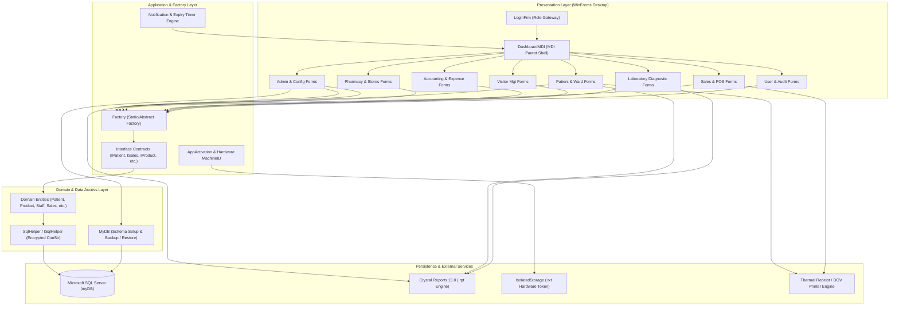
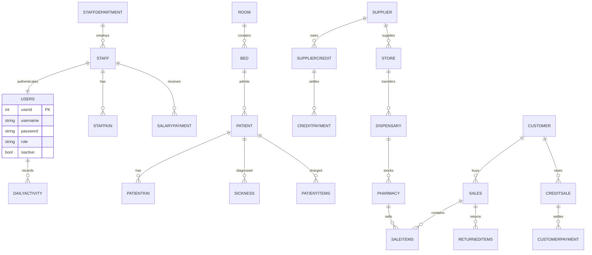
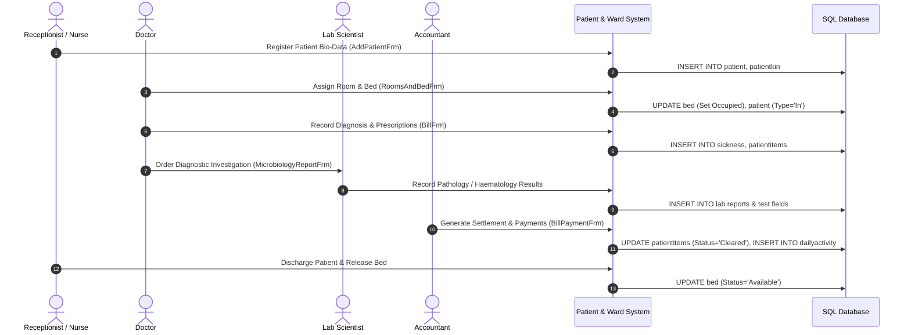

# ChucksMedicareApp — Project & Architecture Map

## 1. Executive Summary

**ChucksMedicareApp** is an enterprise-grade Hospital Information and Management System (HIMS) and Pharmacy/POS desktop application developed in C# (.NET Framework 4.5 WinForms). It coordinates healthcare administration, in-patient and out-patient clinical workflows, multi-tier pharmaceutical inventory and dispensary tracking, point-of-sale billing, clinical laboratory investigations, hospital accounting, visitor security, and hardware-locked application licensing.

---

## 2. High-Level Architecture Diagram



---

## 3. Directory & Module Organization Map

The repository root is organized as follows:

```
ChucksMedicareApp/
├── ChucksMedicareApp.sln                 # Visual Studio Solution File
├── ChucksMedicare/                       # Core WinForms Application Project
│   ├── Program.cs                        # Application Entry Point
│   ├── App.config                        # Application & Encrypted DB Configurations
│   ├── DashboardMDI.cs                   # Central MDI Parent Shell & Background Monitors
│   ├── API/                              # UI Forms & Feature Modules
│   │   ├── Accounting/                   # Income, Expenses & Activity Management
│   │   ├── Configuartion/                # DB Settings, Backups & Receipt Setup
│   │   ├── Indoor_Sales/                 # In-House / Clinical Consumable Sales
│   │   ├── Labouratory/                  # Clinical Test Forms & Pathology Reports
│   │   ├── Notifiactions/                # Alert Popups & Toast Notifications
│   │   ├── Parmacy Mgt/                  # Main Store, Categories & Suppliers
│   │   ├── Patient API/                  # Patient Registration, Admissions, Bed/Room, Billing
│   │   ├── Receipts/                     # POS & Document Print Formatting
│   │   ├── Reports/                      # Crystal Reports Engine & Viewers
│   │   ├── Sales mgt/                    # Point of Sale, Credits, Debtors & Returns
│   │   ├── Shared/                       # Reusable Sub-Forms (e.g. Next of Kin)
│   │   ├── Staff/                        # Human Resources, Departments & Payroll
│   │   ├── User_controls/                # Reusable UI Controls (AppActivationCtrl)
│   │   ├── User_security/                # Authentication, Passwords & Audit Logs
│   │   └── Visitor_mgt/                  # Reception & Visitor Tracking
│   ├── Model/                            # Domain Entities, Factory & Data Access
│   │   ├── Factory.cs                    # Centralized Factory Instantiator
│   │   ├── Account/                      # Financial Activity Tracking Models
│   │   ├── DBConfig/                     # Database Engine, Settings & Activation Models
│   │   ├── Helper/                       # DB Helper, Print Helper & Style Utilities
│   │   ├── Inhouse_Sales/                # Indoor Supply Models
│   │   ├── Lab Test/                     # Pathology, Hematology & Urinalysis Models
│   │   ├── Parmacy/                      # Multi-Tier Stock & Catalog Models
│   │   ├── Patient mgt/                  # Patient, Bed/Room & Sickness Records
│   │   ├── Receiption/                   # Visitor Entities
│   │   ├── Sales mgt/                    # Sales Transactions, Invoicing & Debt Payment
│   │   ├── Shared/                       # Base Details & Kin Models
│   │   └── Staff mgt/                    # Staff, Department, Salary & User Auth
│   ├── Interface/                        # Decoupling Contracts (Interfaces)
│   └── Properties/                       # Assembly Meta, Resources & Settings
```

---

## 4. Functional Subsystems Breakdown

### 4.1. Patient Management & Ward Administration
* **Primary Forms**:
  * [`PatientFrm.cs`](file:///C:/Users/LearnuelTech/Desktop/C%23%20Production%20Projects/Production%20Projects/ChucksMedicareApp/ChucksMedicare/API/Patient%20API/PatientFrm.cs) — Central patient directory, search, and action launcher.
  * [`AddPatientFrm.cs`](file:///C:/Users/LearnuelTech/Desktop/C%23%20Production%20Projects/Production%20Projects/ChucksMedicareApp/ChucksMedicare/API/Patient%20API/AddPatientFrm.cs) / [`UpdatePatientFrm.cs`](file:///C:/Users/LearnuelTech/Desktop/C%23%20Production%20Projects/Production%20Projects/ChucksMedicareApp/ChucksMedicare/API/Patient%20API/UpdatePatientFrm.cs) — Bio-data, genotype, blood group, emergency contacts.
  * [`RoomsAndBedFrm.cs`](file:///C:/Users/LearnuelTech/Desktop/C%23%20Production%20Projects/Production%20Projects/ChucksMedicareApp/ChucksMedicare/API/Patient%20API/RoomsAndBedFrm.cs) — Ward, room, and bed allocation.
  * [`BillFrm.cs`](file:///C:/Users/LearnuelTech/Desktop/C%23%20Production%20Projects/Production%20Projects/ChucksMedicareApp/ChucksMedicare/API/Patient%20API/BillFrm.cs) & [`BillPaymentFrm.cs`](file:///C:/Users/LearnuelTech/Desktop/C%23%20Production%20Projects/Production%20Projects/ChucksMedicareApp/ChucksMedicare/API/Patient%20API/BillPaymentFrm.cs) — Patient billing, admission deposits, itemized charges.
  * [`PatientDocumentFrm.cs`](file:///C:/Users/LearnuelTech/Desktop/C%23%20Production%20Projects/Production%20Projects/ChucksMedicareApp/ChucksMedicare/API/Patient%20API/PatientDocumentFrm.cs) — Scanned medical records and diagnostic files.
* **Core Model**: [`Patient.cs`](file:///C:/Users/LearnuelTech/Desktop/C%23%20Production%20Projects/Production%20Projects/ChucksMedicareApp/ChucksMedicare/Model/Patient%20mgt/Patient.cs) (implements `IPatient`, inherits `Sickness`).

### 4.2. Pharmacy & Inventory Management
* **Three-Tier Stock Hierarchy**:
  1. **Main Store** (`store` table) — Bulk warehouse receiving from pharmaceutical suppliers.
  2. **Dispensary** (`dispensary` table) — Intermediate stock holding area.
  3. **Pharmacy Counter** (`pharmacy` table) — Dispensing point for retail and out-patient sales.
* **Primary Forms**:
  * [`ProductsFrm.cs`](file:///C:/Users/LearnuelTech/Desktop/C%23%20Production%20Projects/Production%20Projects/ChucksMedicareApp/ChucksMedicare/API/Parmacy%20Mgt/ProductsFrm.cs) — Stock intake, store-to-store transfers, unit conversions.
  * [`CategoryFrm.cs`](file:///C:/Users/LearnuelTech/Desktop/C%23%20Production%20Projects/Production%20Projects/ChucksMedicareApp/ChucksMedicare/API/Parmacy%20Mgt/CategoryFrm.cs) & [`SupplierFrm.cs`](file:///C:/Users/LearnuelTech/Desktop/C%23%20Production%20Projects/Production%20Projects/ChucksMedicareApp/ChucksMedicare/API/Parmacy%20Mgt/SupplierFrm.cs) — Drug classifications and vendor management.
* **Core Model**: [`Product.cs`](file:///C:/Users/LearnuelTech/Desktop/C%23%20Production%20Projects/Production%20Projects/ChucksMedicareApp/ChucksMedicare/Model/Parmacy/Product.cs).

### 4.3. Point of Sale (POS) & Sales Management
* **Features**: Cash and credit sales, real-time receipt generation, customer ledger, debt collection, returns handling, and stock auto-deduction.
* **Primary Forms**:
  * [`ProductSalesFrm.cs`](file:///C:/Users/LearnuelTech/Desktop/C%23%20Production%20Projects/Production%20Projects/ChucksMedicareApp/ChucksMedicare/API/Sales%20mgt/ProductSalesFrm.cs) — POS register with barcode/search lookup.
  * [`SalesRecords.cs`](file:///C:/Users/LearnuelTech/Desktop/C%23%20Production%20Projects/Production%20Projects/ChucksMedicareApp/ChucksMedicare/API/Sales%20mgt/SalesRecords.cs) — Transaction journal and receipt reprinting.
  * [`ReturnPurchaseFrm.cs`](file:///C:/Users/LearnuelTech/Desktop/C%23%20Production%20Projects/Production%20Projects/ChucksMedicareApp/ChucksMedicare/API/Sales%20mgt/ReturnPurchaseFrm.cs) — Customer returns with inventory rollback.
  * [`AddCustomerFrm.cs`](file:///C:/Users/LearnuelTech/Desktop/C%23%20Production%20Projects/Production%20Projects/ChucksMedicareApp/ChucksMedicare/API/Sales%20mgt/AddCustomerFrm.cs) — Customer database and debtors log.
* **Core Model**: [`Sales.cs`](file:///C:/Users/LearnuelTech/Desktop/C%23%20Production%20Projects/Production%20Projects/ChucksMedicareApp/ChucksMedicare/Model/Sales%20mgt/Sales.cs).

### 4.4. Laboratory & Diagnostic Investigations
* **Diagnostic Disciplines**:
  * **Haematology**: Full blood count, differential WBC, ESR, hemoglobin genotype.
  * **Chemical Pathology**: Fasting blood sugar, urea, creatinine, liver function tests (SGOT/SGPT/Bilirubin), serum electrolytes ($Na^+$, $K^+$, $Cl^-$).
  * **Microbiology & Parasitology**: Urine microscopy, stool microscopy, semen fluid analysis, culture and sensitivity.
* **Primary Forms**:
  * [`MicrobiologyReportFrm.cs`](file:///C:/Users/LearnuelTech/Desktop/C%23%20Production%20Projects/Production%20Projects/ChucksMedicareApp/ChucksMedicare/API/Labouratory/MicrobiologyReportFrm.cs)
  * [`LabReport.cs`](file:///C:/Users/LearnuelTech/Desktop/C%23%20Production%20Projects/Production%20Projects/ChucksMedicareApp/ChucksMedicare/API/Labouratory/LabReport.cs)
* **Core Models**: [`Labouratory.cs`](file:///C:/Users/LearnuelTech/Desktop/C%23%20Production%20Projects/Production%20Projects/ChucksMedicareApp/ChucksMedicare/Model/Lab%20Test/Labouratory.cs), [`Pathology.cs`](file:///C:/Users/LearnuelTech/Desktop/C%23%20Production%20Projects/Production%20Projects/ChucksMedicareApp/ChucksMedicare/Model/Lab%20Test/Pathology.cs), [`Heamotology.cs`](file:///C:/Users/LearnuelTech/Desktop/C%23%20Production%20Projects/Production%20Projects/ChucksMedicareApp/ChucksMedicare/Model/Lab%20Test/Heamotology.cs).

### 4.5. Staff Management & Payroll
* **Features**: Staff profiles, departmental assignment, credential document scans, salary payment processing, and payment histories.
* **Primary Forms**:
  * [`StaffFrm.cs`](file:///C:/Users/LearnuelTech/Desktop/C%23%20Production%20Projects/Production%20Projects/ChucksMedicareApp/ChucksMedicare/API/Staff/StaffFrm.cs)
  * [`StaffPaymentFrm.cs`](file:///C:/Users/LearnuelTech/Desktop/C%23%20Production%20Projects/Production%20Projects/ChucksMedicareApp/ChucksMedicare/API/Staff/StaffPaymentFrm.cs)
  * [`AddDepartmentFrm.cs`](file:///C:/Users/LearnuelTech/Desktop/C%23%20Production%20Projects/Production%20Projects/ChucksMedicareApp/ChucksMedicare/API/Staff/AddDepartmentFrm.cs)
* **Core Models**: [`Staff.cs`](file:///C:/Users/LearnuelTech/Desktop/C%23%20Production%20Projects/Production%20Projects/ChucksMedicareApp/ChucksMedicare/Model/Staff%20mgt/Staff.cs), [`StaffPayment.cs`](file:///C:/Users/LearnuelTech/Desktop/C%23%20Production%20Projects/Production%20Projects/ChucksMedicareApp/ChucksMedicare/Model/Staff%20mgt/StaffPayment.cs).

### 4.6. Hospital Accounting & Cash Flow
* **Features**: Daily income and expense entries, balance ledger, date range auditing, and expense classification.
* **Primary Forms**:
  * [`ExpensesFrm.cs`](file:///C:/Users/LearnuelTech/Desktop/C%23%20Production%20Projects/Production%20Projects/ChucksMedicareApp/ChucksMedicare/API/Accounting/ExpensesFrm.cs)
  * [`ExpenseMgtFrm.cs`](file:///C:/Users/LearnuelTech/Desktop/C%23%20Production%20Projects/Production%20Projects/ChucksMedicareApp/ChucksMedicare/API/Accounting/ExpenseMgtFrm.cs)
  * [`AccountManagementFrm.cs`](file:///C:/Users/LearnuelTech/Desktop/C%23%20Production%20Projects/Production%20Projects/ChucksMedicareApp/ChucksMedicare/API/Accounting/AccountManagementFrm.cs)
* **Core Model**: [`DailyActivity.cs`](file:///C:/Users/LearnuelTech/Desktop/C%23%20Production%20Projects/Production%20Projects/ChucksMedicareApp/ChucksMedicare/Model/Account/DailyActivity.cs).

### 4.7. System Administration & Database Configuration
* **Features**: Database connection configuration, encrypted connection strings, automated schema creation (`script.sql`), full database backups (`.bak`), and POS receipt layout customization.
* **Primary Forms**:
  * [`DatabaseConfigurationFrm.cs`](file:///C:/Users/LearnuelTech/Desktop/C%23%20Production%20Projects/Production%20Projects/ChucksMedicareApp/ChucksMedicare/API/Configuartion/DatabaseConfigurationFrm.cs)
  * [`DatabaseBackupFrm.cs`](file:///C:/Users/LearnuelTech/Desktop/C%23%20Production%20Projects/Production%20Projects/ChucksMedicareApp/ChucksMedicare/API/Configuartion/DatabaseBackupFrm.cs)
  * [`ReceiptFrm.cs`](file:///C:/Users/LearnuelTech/Desktop/C%23%20Production%20Projects/Production%20Projects/ChucksMedicareApp/ChucksMedicare/API/Configuartion/ReceiptFrm.cs)
* **Core Model**: [`MyDB.cs`](file:///C:/Users/LearnuelTech/Desktop/C%23%20Production%20Projects/Production%20Projects/ChucksMedicareApp/ChucksMedicare/Model/DBConfig/MyDB.cs).

### 4.8. Security, Licensing & Expiry Alert System
* **Features**:
  * **Role-Based Access Control**: Filtered menu navigation depending on user role.
  * **Hardware-Locked Licensing**: `MachineID_DLL` extracts hardware UUID, bound against `IsolatedStorage` token files.
  * **Dynamic Expiry Background Engine**: Active timers monitor expiring drugs ($<30$ days) and out-of-stock items, popping toast alerts via [`NotificationFrm.cs`](file:///C:/Users/LearnuelTech/Desktop/C%23%20Production%20Projects/Production%20Projects/ChucksMedicareApp/ChucksMedicare/API/Notifiactions/NotificationFrm.cs).

---

## 5. Role-Based Access Control (RBAC) Matrix

Derived from [`Users.cs`](file:///C:/Users/LearnuelTech/Desktop/C%23%20Production%20Projects/Production%20Projects/ChucksMedicareApp/ChucksMedicare/Model/Staff%20mgt/Users.cs#L378-L408):

| Role Name | RoleID | Patients & Wards | Pharmacy Stock | POS Sales | Laboratory | Accounting | Admin & Staff HR | DB & Settings |
|---|:---:|:---:|:---:|:---:|:---:|:---:|:---:|:---:|
| **Administrator** | `7` | Full | Full | Full | Full | Full | Full | Full |
| **Sales Manager** | `6` | View | Full | Full | View | View | No | Settings Only |
| **Accountant** | `5` | Billing | View | Records | View | Full | View Pay | Settings Only |
| **Nurse / Doctor** | `4` | Full Clinical | View | No | View/Order | No | No | Settings Only |
| **Lab Scientist** | `3` | Lab Files | No | No | Full Reports | No | No | Settings Only |
| **Sales Rep** | `2` | No | Dispense | POS Only | No | No | No | Settings Only |
| **Receptionist** | `1` | Register | No | No | No | No | No | Settings Only |

---

## 6. Database Entity-Relationship (ER) Map



---

## 7. Key Data & Business Workflows

### 7.1. In-Patient Admission & Care Lifecycle


### 7.2. Multi-Store Inventory & Point-of-Sale Flow
```mermaid
sequenceDiagram
    autonumber
    actor Sup as Supplier
    actor Mgr as Inventory Manager
    actor Rep as Sales Rep
    actor Cust as Customer
    participant Inv as Product / Store System
    participant POS as POS Sales Engine
    participant DB as SQL Database

    Sup->>Mgr: Deliver Goods
    Mgr->>Inv: Stock Entry into Main Store (ProductsFrm)
    Inv->>DB: INSERT/UPDATE store
    Mgr->>Inv: Move Stock to Dispensary
    Inv->>DB: UPDATE store (Deduct), UPDATE dispensary (Add)
    Mgr->>Inv: Transfer Stock to Pharmacy Shelf
    Inv->>DB: UPDATE dispensary (Deduct), UPDATE pharmacy (Add)
    Cust->>Rep: Purchase Items at POS Counter
    Rep->>POS: Process Sale & Print Receipt (ProductSalesFrm)
    POS->>DB: INSERT INTO sales, saleitems; UPDATE pharmacy (Deduct)
    POS->>Cust: Issue Printed Thermal Receipt
```

---

## 8. Technology Stack Summary

* **Application Framework**: Windows Forms (WinForms), .NET Framework 4.5
* **Programming Language**: C# 5.0
* **Database Engine**: Microsoft SQL Server 2008 / 2012 / 2016+
* **Data Access**: Direct ADO.NET (`System.Data.SqlClient`) with Parameterized Queries
* **Reporting Engine**: Crystal Reports for Visual Studio (`CrystalDecisions.CrystalReports.Engine`)
* **Hardware & Licensing Protection**:
  * `MachineID_DLL` (Machine hardware signature extraction)
  * `EncryptString` & `EncryptPassword35` (Cryptographic key generation & SHA password hashing)
  * `IsolatedStorage` (Local encrypted token validation)
* **Printing Integration**: Thermal POS Receipt generation & `DGVPrinterHelper` for custom DataGridView tabular output.
