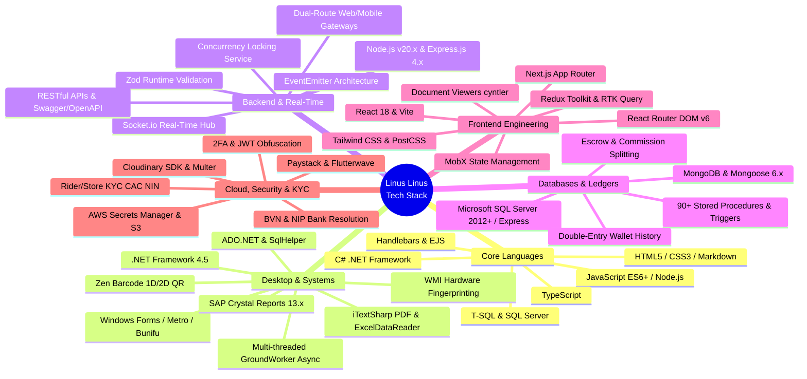
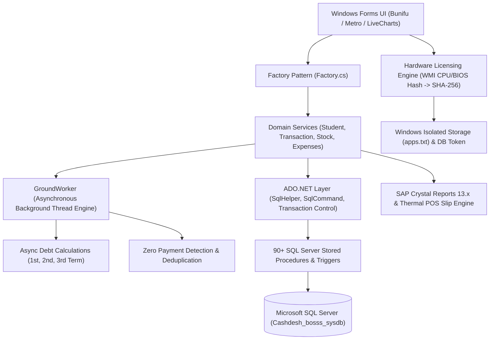
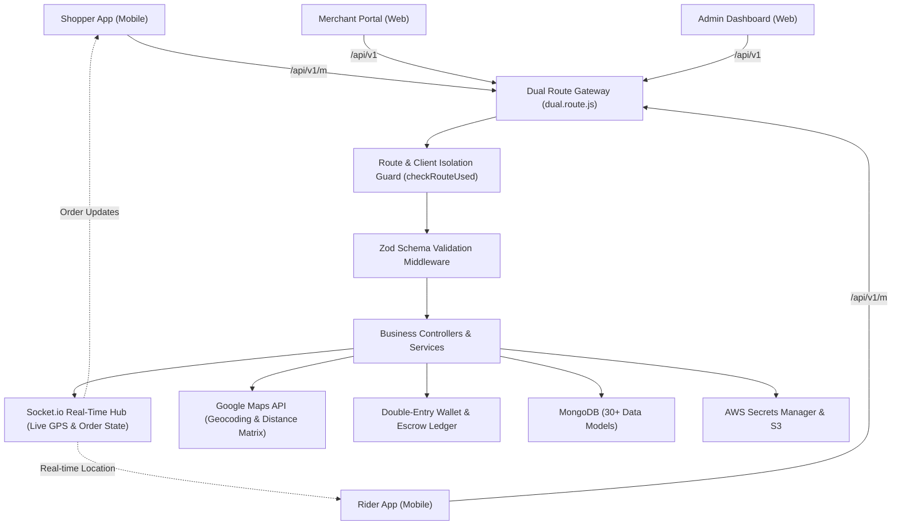
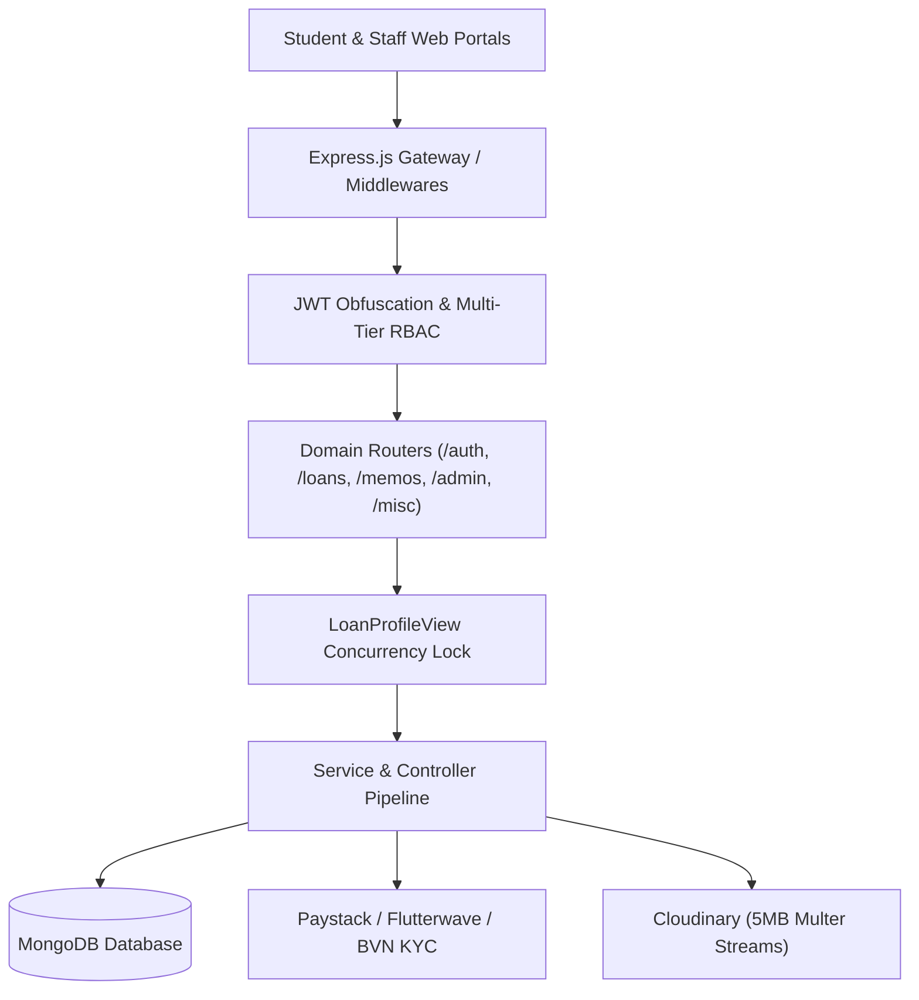
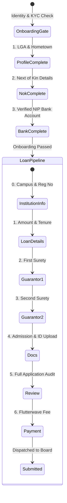
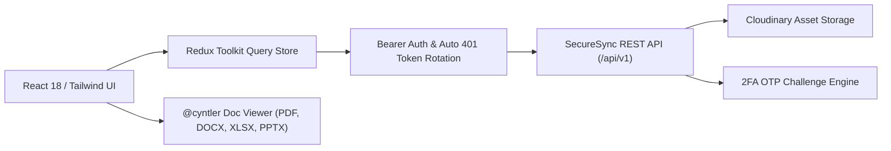

# AGENT SPECIFICATION & DEVELOPER PROFILE BLUEPRINT
## Linus Linus — Senior Full-Stack, Systems & Desktop Software Architect

> **Document Type:** Autonomous Agent Execution Document / Portfolio Master Blueprint  
> **Target Developer:** Linus Linus  
> **Headshot Asset:** `./linus_linus-photo.jpg`  
> **Source Documents Analyzed:**  
> 1. `grubbex-map.md` (Grubbex Backend API — Multi-Sided Logistics Marketplace, Real-Time WebSockets & Escrow Ledger)  
> 2. `CASHDESK_DOCUMENTATION.md` (Cash Desk Application — Enterprise .NET / C# Desktop Financial Suite, Bursary, POS & Stored Procedures)  
> 3. `PROJECT_MAP.md` (BYHELB / BYSHELB LMS Backend v2 — Distributed Government Loan Management Engine)  
> 4. `SITEMAP.md` (BYSHELB Student Loan Portal Frontend v2 — Complex Multi-Step Wizard & Onboarding Engine)  
> 5. `SITEMAP2.md` (SecureSync Cloud Storage & Document Collaboration Platform)  

---

## 1. Executive Purpose & Instructions for the Agent

### 1.1 Objective
You are an expert autonomous software engineer and UI/UX designer tasked with building a modern, high-performance, visually stunning developer portfolio website for **Linus Linus**. 

This portfolio must authentically reflect Linus's comprehensive engineering expertise spanning **Cloud & Real-Time Backends (Node.js/Express/Socket.io)**, **Enterprise Desktop & Financial Systems (.NET/C#/Microsoft SQL Server)**, **Modern Web Frontends (React 18/Redux/MobX)**, and **Distributed System Architecture**.

### 1.2 Agent Execution Mandates
When building or scaffolding the portfolio website, the agent must adhere to the following rules:
1. **Accurate Representation:** Use the exact technologies, architectures, workflows, and integrations cataloged in this document across all 5 flagship systems.
2. **Featured Projects:** Deeply highlight the five verified enterprise projects:
   - **Grubbex Backend API** (Real-time on-demand delivery marketplace, Socket.io geo-dispatching, Zod validation, double-entry wallet ledger, dual-route gateway, QR handover).
   - **Cash Desk (.NET/C# WinForms Suite)** (Enterprise bursary accounting, multi-threaded `GroundWorker` debt computation, digital pocket-money wallet, barcode POS, 90+ SQL stored procedures, WMI hardware licensing, Crystal Reports).
   - **BYHELB LMS Backend v2** (State Government FinTech & Distributed Loan Processing Engine, 8-tier RBAC, batch memos, concurrency locks).
   - **BYSHELB Student Portal v2** (Multi-tier Citizen Onboarding & 7-Stage Application Wizard).
   - **SecureSync** (Secure Cloud Storage, In-App Doc Viewer, Granular Sharing & 2FA Engine).
3. **Asset Utilization:** Embed `./linus_linus-photo.jpg` prominently in the hero and about sections with optimized responsive rendering.
4. **Design Quality:** Implement an aesthetic reflecting senior engineering craft: dark-mode primary theme (with clean light mode toggle), high-contrast typography, interactive system architecture diagrams (Mermaid or interactive SVG/canvas), subtle micro-animations (Framer Motion), and code-informed components (pill badges, API route chips, state machine indicators).

---

## 2. Developer Persona & Brand Identity

### 2.1 Profile Summary
- **Full Name:** Linus Linus
- **Professional Title:** Senior Full-Stack, Systems & Desktop Software Architect
- **Tagline:** *Engineering resilient FinTech backends, enterprise desktop accounting suites, and high-throughput real-time platforms.*
- **Core Focus:** Enterprise Node.js / Express microservices, C# / .NET Framework desktop architecture, Microsoft SQL Server (T-SQL stored procedures) & MongoDB, real-time WebSockets (Socket.io), double-entry financial ledgers & digital wallets, and modern React 18 frontends.
- **Location / Timezone:** West Africa (WAT) / Remote Available Worldwide
- **Avatar / Profile Photo:** `linus_linus-photo.jpg`
- **GitHub:** [https://www.github.com/Learnuel1](https://www.github.com/Learnuel1) (`@Learnuel1`)
- **LinkedIn:** [https://www.linkedin.com/in/linus-linus-i](https://www.linkedin.com/in/linus-linus-i)
- **Primary Emails:** [linus.linus204@gmail.com](mailto:linus.linus204@gmail.com) | [linus.zoea@gmail.com](mailto:linus.zoea@gmail.com)
- **Phone Numbers:** [+2348120484386](tel:+2348120484386), [+2348113664697](tel:+2348113664697)
- **Official Resume / CV Assets:**
  - Local Markdown: [LINUS_LINUS_CV.md](file:///c:/Users/LearnuelTech/Desktop/PROJECTS/linus-linus-portfolio/LINUS_LINUS_CV.md)
  - Local PDF: [LINUS_LINUS_CV.pdf](file:///c:/Users/LearnuelTech/Desktop/PROJECTS/linus-linus-portfolio/LINUS_LINUS_CV.pdf)
  - Google Docs (Editable Workspace): [Google Doc Version](https://docs.google.com/document/d/1uOnFfa2ZRpZ_U-90RfCxj0ReTtMGGUOoNQq_LFtVNmc/edit?usp=drivesdk)
  - Google Drive (Cloud File): [Google Drive File](https://drive.google.com/file/d/1o1C48lP8keqf3cCCuF4N0q7RDl4bNPz6/view?usp=drivesdk)

### 2.2 Elevator Pitches (Pre-written Copy)

#### Short Bio (Hero / Socials)
> Senior Full-Stack & Systems Architect with extensive production experience building enterprise desktop financial accounting suites (.NET/C#/SQL Server), real-time on-demand logistics marketplaces (Node.js/Socket.io/Google Maps), government loan processing engines, and secure cloud collaboration platforms. Expert in multi-threaded asynchronous computation, double-entry ledgers, and zero-trust security.

#### Medium Bio (About Section)
> Linus Linus is a multi-platform Software Engineer and Systems Architect whose experience spans high-performance Windows desktop enterprise suites, distributed cloud backends, and responsive modern web applications. Linus has architected enterprise institutional bursary and campus commerce suites in C#/.NET managing multi-term fee billing, asynchronous background debt calculation engines, and barcode-enabled POS systems with 90+ SQL Server stored procedures; on-demand logistics marketplaces dispatching couriers via Socket.io and Google Maps; government loan platforms handling audited financial disbursements; and encrypted cloud storage systems.
> 
> Unifying every project is Linus's commitment to computational rigor: ACID-compliant transactions, double-entry financial accounting, hardware-bound anti-tamper licensing (WMI SHA-256), active concurrency locks, and centralized runtime schema validation.

#### Philosophy & Approach
- **Multi-Platform Engineering:** Seamlessly bridging enterprise desktop architectures (.NET/C#, ADO.NET, Windows Services, WMI) and cloud web ecosystems (Node.js, React 18, WebSockets).
- **Financial & Ledger Integrity:** Enforcing strict double-entry accounting across student wallets, courier escrows, and bank teller reconciliations with transactional ACID guarantees.
- **Asynchronous Background Processing:** Offloading intensive reconciliations—such as institutional debt audits or geo-radius courier searches—into non-blocking background workers (`Task.Run()`, `GroundWorker`, `EventEmitter`).
- **Defensive Security & Anti-Tamper:** Implementing machine-bound hardware fingerprinting (WMI CPU/BIOS hashing), two-factor license persistence, symmetric JWT obfuscation, and runtime schema validation (Zod, Yup).

---

## 3. Comprehensive Technology & Tooling Matrix



### 3.1 Categorized Skill Inventory

| Category | Tools, Technologies & Protocols |
|---|---|
| **Programming Languages** | C# (5.0/6.0), JavaScript (ES6+, ESNext), Node.js (v18.x, v20.x), TypeScript, T-SQL, HTML5, CSS3, Handlebars, EJS |
| **Desktop & Systems (.NET)** | Microsoft .NET Framework 4.5, Windows Forms, ADO.NET (`SqlCommand`, `SqlDataAdapter`, `SqlHelper`), WMI (`Win32_Processor`, `Win32_BIOS`), Multi-threading (`Task.Run()`, background reconciliation), Windows Isolated Storage, Factory Pattern, LiveCharts (WinForms/WPF), Bunifu UI, MetroFramework |
| **Databases & Persistence** | Microsoft SQL Server (2012 - 2022 / Express), 90+ Stored Procedures, Triggers, Views, ACID Transactions, File-level database backup/restore (`.mdf`/`.ldf`), MongoDB & Mongoose 6.x (Aggregation pipelines, soft deletes, indexing) |
| **Reporting & Barcode Engines** | SAP Crystal Reports 13.x, Zen Barcode Rendering Framework (Code128 1D & QR Code 2D), `iTextSharp` PDF generation, `ExcelDataReader` (binary `.xlsx`/`.xls` parsing) |
| **Backend & Real-Time** | Node.js, Express.js 4.x, Socket.io (WebSocket real-time hub), Node.js `EventEmitter`, Dual-Route Gateway Architecture (`/api/v1` vs `/api/v1/m`), Layered Service Architecture |
| **Geospatial & Logistics** | Google Maps Platform (Geocoding & Distance Matrix API), Haversine geo-radius courier dispatch (`getOrdersWithinRadius`), Courier GPS & Geofencing, QR Code Handover |
| **FinTech & Financial Ledgers** | Double-entry wallet ledgers (`Wallet` & `WalletHistory` / `Transactions`), Platform escrow hold, Commission calculation engines, Paystack API, Flutterwave SDK, Bloc API, Bank Verification Number (BVN) resolution, NIP commercial bank lookup, Bank teller slip reconciliation |
| **Compliance & KYC** | Multi-tier KYC verification (Virtual NIN, Voter's Card, Driver's License, Corporate CAC registration, TIN tax IDs, Bank Account resolution) |
| **Security & Cryptography** | WMI hardware fingerprinting (SHA-256 machine ID), JWT symmetric claims obfuscation, Two-Factor Authentication (2FA), `bcryptjs`, AES/TripleDES connection string encryption, RBAC multi-tier guards |
| **Cloud Infrastructure & Secrets** | AWS Secrets Manager (`secret.loader.js`), AWS S3, Cloudinary SDK, Multer streaming, Render Cloud Platform |
| **Frontend Frameworks & State** | React 18, Vite, Next.js, Redux Toolkit (`@reduxjs/toolkit`), RTK Query (auto 401 token refresh), `redux-persist`, MobX, React Router DOM v6 (`createBrowserRouter`) |
| **UI Styling & Document Viewers** | Tailwind CSS, PostCSS, Lucide React, React Icons, Styled Components, `@cyntler/react-doc-viewer`, `react-file-viewer` |
| **Messaging & Notifications** | Brevo (Sendinblue), SendGrid, Mailgun, Nodemailer SMTP, Firebase OTP |
| **Logging & Observability** | Winston, Winston-MongoDB (persistent log collections), Morgan HTTP logger |

---

## 4. Flagship Project Case Studies

The agent must structure the portfolio's project showcase around these five deep-dive case studies:

---

### Project 1: Cash Desk (CashDeskApp) — Enterprise Bursary, POS & Campus Commerce Suite
*Enterprise Windows Desktop Financial Management, Double-Entry Student Wallet & Automated Audit Engine*

- **Role:** Lead Desktop & Systems Architect
- **Stack:** C# (.NET Framework 4.5), Windows Forms, Microsoft SQL Server 2012+ (T-SQL), ADO.NET, SAP Crystal Reports 13.x, LiveCharts, Zen Barcode, ExcelDataReader, WMI Cryptography.
- **Summary:** An enterprise-grade Windows desktop financial management and accounting suite tailored for primary and secondary educational institutions, unifiying student fee billing, installment scheduling, bank teller voucher reconciliation, cashless campus digital wallets, barcode-enabled POS inventory, and automated background debt computation.

#### Architecture Diagram:


#### Key Engineering Achievements & Features:
1. **Asynchronous Multi-Threaded Debt Engine (`GroundWorker`):** Designed a non-blocking background reconciliation subsystem (`Task.Run()`) executing concurrent term-by-term debt audits (`FirstTermDebtAsync`, `SecondTermDebtAsync`, `ThirdTermDebtAsync`), zero-payment scans, and automatic duplicate debtor elimination on application launch without freezing the UI.
2. **Student Digital Wallet & Cashless Campus ("Pocket Money"):** Engineered a cashless payment ecosystem tied 1:1 to student matriculation numbers, supporting individual deposits, bulk parent funding by class/arm (`BulkFund`), automated Balance Brought Forward (`BF`) session rollover (`sp_credit_brought_forward`), and real-time POS debiting.
3. **Point of Sale (POS) & Store Inventory Subsystem:** Built high-speed barcode checkout supporting Code128 1D and QR 2D scanning (`Zen.Barcode`), multi-tender settlements (Pocket Money, Cash, Bank, Issued, Credit), term-end physical stock reconciliation with discrepancy reporting, and `LiveCharts` gross inventory turnover analytics.
4. **Hardware-Bound Anti-Tamper Licensing:** Created a proprietary machine-licensing engine querying WMI (`Win32_Processor.ProcessorId` and `Win32_BIOS.SerialNumber`) to compute a machine SHA-256 hash, verified against activation keys stored across two-factor storage (SQL database + Windows Isolated Storage) with a 120-record demo trial safeguard.
5. **Robust ADO.NET Architecture with 90+ Stored Procedures:** Combined direct parameterized ADO.NET queries for lightweight form searches with over 90 compiled SQL Server stored procedures enforcing ACID transactional integrity.
6. **Built-in Disaster Recovery & Schema Provisioner:** Automated database migration (`MyDB.cs`, `Script.sql`) and file-level atomic database backups pausing SQL Server services for physical `.mdf`/`.ldf` copies.

---

### Project 2: Grubbex Backend API — Multi-Sided On-Demand Logistics & Delivery Marketplace
*Real-Time Logistics Engine, Geo-Radius Dispatching, Escrow & Wallet Architecture*

- **Role:** Lead Backend & Distributed Systems Architect
- **Stack:** Node.js, Express.js, Socket.io, MongoDB (Mongoose), Zod, Google Maps Platform, AWS Secrets Manager, AWS S3, Cloudinary, Paystack, Flutterwave, Brevo.
- **Summary:** High-concurrency backend API and real-time WebSocket hub powering an on-demand food and grocery logistics marketplace connecting Shoppers, Couriers (Riders), Merchant Stores, and Platform Administrators.

#### Architecture Diagram:


#### Key Engineering Achievements & Features:
1. **Dual-Route Platform Isolation:** Separates Web clients (`/api/v1`) from Mobile clients (`/api/v1/m`), strictly enforced via `checkRouteUsed` to prevent unauthorized client impersonation.
2. **Real-Time Geo-Radius Courier Dispatching:** Proximity matching using Google Maps Geocoding and Haversine distance calculations (`getOrdersWithinRadius`) to broadcast pending store pickups to couriers within active geo-fences via Socket.io.
3. **Cryptographic Delivery Handover Verification:** Dynamic QR code generation paired with 6-digit cryptographic PINs verified by couriers on customer handover.
4. **Double-Entry Financial Ledger & Escrow:** Shopper payments held in platform escrow, courier commissions programmatically deducted upon verified handover, and rider/merchant wallets credited with full audit trails in `WalletHistory`.
5. **Centralized Zod Validation:** Type-safe runtime schema pipelines validating payloads, query parameters, and route parameters across all endpoints.

---

### Project 3: BYHELB LMS Backend v2 — Distributed Loan Management System
*Enterprise Government FinTech Application & Multi-Tier Governance Engine*

- **Role:** Lead Backend Architect & API Engineer
- **Stack:** Node.js (v20), Express.js 4.x, MongoDB (Mongoose 6.x), Winston, Swagger/OpenAPI, Paystack, Flutterwave, Cloudinary, SendGrid.
- **Summary:** Central backend engine powering the Bayelsa State Higher Education Loans Board (BYSHELB), automating tertiary student loan applications, multi-tier civil service governance, KYC identity verification, and multi-million naira loan batch disbursements.

#### System Architecture Diagram:


#### Key Engineering Achievements & Features:
1. **Multi-Tier Administrative Governance Pipeline:** Built an 8-role permission hierarchy (`super_admin`/`es`, `lph`, `la`, `lo`, `acc`, `fdo`, `blog`, `student`).
2. **Internal Approval Memo Routing:** Developed an internal bureaucratic memo system where verified student loans are bundled into cryptographically tracked memos flowing across audit, legal, and executive sign-off before accountant disbursement.
3. **Concurrency Control (Loan Profile View Lock):** Implemented an active database lock mechanism (`LoanProfileView`) preventing multiple loan officers from making conflicting assessments on the same application simultaneously.
4. **KYC & Banking Automation:** Integrated live Bank Verification Number (BVN) resolution and NIP commercial bank account lookup.
5. **Security & Obfuscation:** Designed custom Base64/Hex symmetric claim encryption inside JWT payloads.

---

### Project 4: BYSHELB Student Loan Portal Frontend (`lms-fe-v2`)
*Citizen-Facing Tertiary Loan Application Platform & Multi-Step Wizard Engine*

- **Role:** Lead Frontend Engineer
- **Stack:** React 18, Vite / Next.js, MobX State Management, React Router DOM, Styled Components, Flutterwave Inline SDK.
- **Summary:** High-throughput, accessible student loan portal enabling thousands of undergraduate and postgraduate students from Bayelsa State to register, verify identity, complete complex financial applications, and accept disbursement offers.

#### Multi-Step Flow Diagram:


#### Key Engineering Achievements & Features:
1. **3-Stage Prerequisite Onboarding Gatekeeper:** Enforces bio-data, verified emergency contact, and bank account resolution before unlocking loan applications.
2. **7-Stage Progressive Application Wizard:** Architected an isolated step provider (`UndergraduateLoanStepProvider`) managing stage persistence, form state, and draft resumption across undergraduate, postgraduate, and professional loan tracks.
3. **Guarantor & Surety Management System:** Built digital verification workflows including downloadable official legal forms and multi-party attestation uploads.

---

### Project 5: SecureSync Cloud Storage Platform (`secure-sync-js`)
*Modern Encrypted Cloud Storage & Document Collaboration Platform*

- **Role:** Full-Stack Web Application Engineer
- **Stack:** React 18, Vite, Redux Toolkit, RTK Query, Tailwind CSS, PostCSS, Lucide Icons, `@cyntler/react-doc-viewer`, `react-hook-form`, Yup, Render Cloud API.
- **Summary:** An intuitive, privacy-centric cloud storage application enabling users to upload, preview, organize, and securely share documents with granular permission controls, two-factor authentication, and dynamic quota management.

#### RTK Query & Security Architecture:


#### Key Engineering Achievements & Features:
1. **Automated Token Rotation & RTK Query Architecture:** Engineered API data-fetching layer with automatic JWT bearer attachment, silent token re-authentication on 401 Unauthorized responses, and optimistic state caching.
2. **In-App Multi-Format Document Viewer:** Native in-browser rendering for office documents (`.docx`, `.xlsx`, `.pptx`), PDFs, and imagery.
3. **Granular Collaboration & Sharing Controls:** Built granular file-sharing modals allowing users to grant View-only or Download permissions, generate public reference preview links, and revoke access instantly.
4. **Two-Factor Authentication (2FA) & Recovery:** Created an end-to-end 2FA security settings panel with OTP challenge prompts, countdown resend timers, and secure password recovery workflows.

---

## 5. Target Portfolio Website Architecture & Specifications

### 5.1 Recommended Technical Stack for Portfolio
- **Framework:** Next.js 14+ (App Router) or React 18 with Vite
- **Styling:** Tailwind CSS + PostCSS + CSS variables for sleek dark/light themes
- **Animations:** Framer Motion (subtle scroll reveals, layout animations, modal transitions)
- **Icons:** Lucide React (modern, clean, minimal icons)
- **Components & Primitives:** Radix UI / Shadcn UI inspired components (Tabs, Dialogs, Tooltips, Accordions)
- **Diagrams:** Mermaid.js or custom interactive SVG diagrams visualizing system workflows
- **Form Handling:** React Hook Form + EmailJS / Formspree / API route for contact messages

### 5.2 Page & Section Structure

```
Portfolio Site Layout
├── 1. Navigation Bar (Sticky, blur backdrop, brand logo, section anchors, Resume button, Theme toggle)
├── 2. Hero Section
│   ├── Headshot Photo (linus_linus-photo.jpg with glowing backdrop)
│   ├── Status Pill ("Available for Senior Full-Stack, Systems & Desktop Roles")
│   ├── Main Headline ("Architecting Enterprise FinTech, Desktop Suites & Real-Time Logistics")
│   ├── Concise Value Proposition
│   ├── Primary CTAs ("Explore 5 Flagship Projects", "View Architecture", "Contact Linus")
│   └── Tech Stack Marquee (C#, .NET, Node.js, Express, React, SQL Server, MongoDB, Socket.io, Redux)
├── 3. About & Engineering Philosophy
│   ├── Multi-platform journey: From C# Windows enterprise suites to distributed cloud & real-time engines
│   ├── Key Metrics (5 Production Systems, 90+ SQL Stored Procs, Multi-Million Loan & Payout Batches)
│   └── Architectural Principles (Deterministic State, Double-Entry Accounting, Non-Blocking Workers)
├── 4. Technical Skills & Capability Matrix
│   ├── Interactive Tabbed Grid:
│   │   ├── Languages (C#, JavaScript, TypeScript, T-SQL)
│   │   ├── Desktop & Systems (.NET, ADO.NET, WMI, WinForms, Crystal Reports)
│   │   ├── Backend & Real-Time (Node.js, Express, Socket.io, Zod)
│   │   ├── Databases & Persistence (SQL Server Stored Procedures, MongoDB)
│   │   ├── FinTech & Ledgers (Double-Entry Wallets, Escrow, Paystack, Flutterwave)
│   │   └── Frontend & Cloud (React 18, Redux, RTK Query, Tailwind, AWS)
├── 5. Featured Projects Showcase (5 Deep-Dive Showcases)
│   ├── Case 1: Cash Desk (.NET / C# Enterprise Bursary & POS Accounting Suite)
│   ├── Case 2: Grubbex Backend API (Real-time logistics marketplace, Socket.io, Zod, QR handover)
│   ├── Case 3: BYHELB LMS Backend v2 (8-tier RBAC, batch memo routing, concurrency locks)
│   ├── Case 4: BYSHELB Student Portal v2 (7-step wizard visualizer, onboarding gatekeeper demo)
│   └── Case 5: SecureSync Cloud Storage (In-app viewer preview, RTK Query token rotation flow)
├── 6. Interactive Architecture Playground
│   ├── Visualizer 1: Cash Desk Asynchronous Debt Reconciler (GroundWorker multi-thread flow)
│   ├── Visualizer 2: Grubbex Order Lifecycle & Escrow Handover
│   └── Visualizer 3: BYHELB Multi-Tier Loan State Machine
├── 7. Contact & Collaboration
│   ├── Working message form (Name, Email, Subject, Message)
│   ├── Direct channels:
│   │   ├── Emails: linus.linus204@gmail.com, linus.zoea@gmail.com
│   │   ├── Phone: +2348120484386, +2348113664697
│   │   ├── GitHub: https://www.github.com/Learnuel1
│   │   └── LinkedIn: https://www.linkedin.com/in/linus-linus-i
│   ├── Location / Timezone: West Africa (WAT) / Remote Available Worldwide
│   └── Download Resume / CV CTA
└── 8. Footer (Copyright Linus Linus, source link, tech stack footer note)
```

---

## 6. Agent Implementation Tasks (Step-by-Step)

When tasked with generating the codebase for this portfolio, the agent must execute the following chronological tasks:

### Task 1: Environment & Project Scaffolding
- Initialize a modern Vite + React (or Next.js) project.
- Install core dependencies: `tailwindcss`, `lucide-react`, `framer-motion`, `clsx`, `tailwind-merge`.
- Copy `./linus_linus-photo.jpg` into the public/assets directory as the primary portrait.
- Copy `./LINUS_LINUS_CV.pdf` into the public directory as `Linus_Linus_CV.pdf` for direct download buttons.

### Task 2: Data Models & Static Content Store
- Create `src/data/portfolio-data.js` containing:
  - Personal info, bio paragraphs, and verified contact channels:
    - GitHub: `https://www.github.com/Learnuel1`
    - LinkedIn: `https://www.linkedin.com/in/linus-linus-i`
    - Emails: `linus.linus204@gmail.com`, `linus.zoea@gmail.com`
    - Phone: `+2348120484386`, `+2348113664697`
    - CV Download Link: `/Linus_Linus_CV.pdf`
    - Google Docs Workspace CV: `https://docs.google.com/document/d/1uOnFfa2ZRpZ_U-90RfCxj0ReTtMGGUOoNQq_LFtVNmc/edit?usp=drivesdk`
  - Full skill matrix categorized by domain (including C#, .NET, SQL Server, Stored Procedures, WMI, Socket.io, Zod, Crystal Reports).
  - Complete case study objects for all 5 projects with problem, solution, features, tech stack, and workflow steps.

### Task 3: Core UI Components
- Build `Navbar` with smooth scrolling to `#about`, `#skills`, `#projects`, `#architecture`, `#contact`.
- Build `Hero` featuring `linus_linus-photo.jpg`, dynamic role badges, and quick contact buttons.
- Build `SkillMatrix` with filterable category tabs and interactive tooltips.
- Build `ProjectCard` with expandable "View System Architecture" modal dialogs for each of the 5 projects.
- Build `ArchitectureVisualizer` rendering the `GroundWorker` multi-threading model and the Grubbex order lifecycle.
- Build `ContactSection` with form validation and feedback toasts.

### Task 4: Polish & Performance Optimization
- Optimize headshot image loading (`loading="eager"` for hero, responsive `srcset` or modern Next.js `Image`).
- Ensure 100% Lighthouse accessibility, SEO meta tags (`og:title`, `og:image`, `og:description`), and responsive viewport safety on mobile devices.
- Verify that every technology, role, endpoint, and architectural pattern cited matches this specification document.

---

## 7. Verification Checklist for the Agent

Before marking the portfolio creation as complete, verify:
- [ ] Developer name is **Linus Linus** throughout.
- [ ] Photo asset `./linus_linus-photo.jpg` is properly linked and visible.
- [ ] All 5 systems (Cash Desk, Grubbex, BYHELB Backend, BYHELB Frontend, SecureSync) are fully articulated with their specific real-world tech stacks.
- [ ] C# and .NET desktop capabilities (ADO.NET, 90+ SQL Stored Procedures, `GroundWorker` multi-threading, WMI hardware licensing, Crystal Reports) are prominently featured.
- [ ] Real-time cloud capabilities (Socket.io hub, Google Maps geo-radius dispatching, Zod validation, double-entry wallet history, QR verification, BVN KYC, Concurrency Locks, RTK Query token rotation) are highlighted.
- [ ] Responsive navigation works smoothly across mobile, tablet, and desktop screens.
- [ ] Interactive state machine and architecture diagrams render without syntax errors.
- [ ] Contact links, resume download placeholders, and social profile links are wired up.
