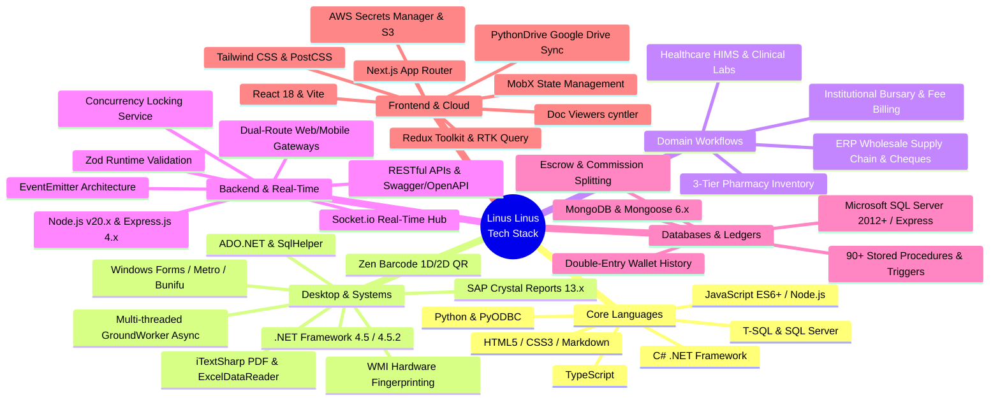

# AGENT SPECIFICATION & DEVELOPER PROFILE BLUEPRINT
## Linus Linus — Senior Full-Stack, Systems & Desktop Software Architect

> **Document Type:** Autonomous Agent Execution Document / Portfolio Master Blueprint  
> **Target Developer:** Linus Linus  
> **Headshot Asset:** `./linus_linus-photo.jpg`  
> **Source Documents Analyzed:**  
> 1. `CASHDESK_DOCUMENTATION.md` (Cash Desk Application — Enterprise .NET / C# Desktop Financial Suite, Bursary, POS & Stored Procedures)  
> 2. `ChuckMedicare_PROJECT_MAP.md` (ChucksMedicareApp — Enterprise Hospital Information & Management System, Clinical Diagnostics & 3-Tier Pharmacy)  
> 3. `SYSTEM_MAP.md` (MM Traders Inventory ERP — Point-of-Sale, Multi-Brand Supply Chain & Google Drive Cloud Backup)  
> 4. `grubbex-map.md` (Grubbex Backend API — Multi-Sided Logistics Marketplace, Real-Time WebSockets & Escrow Ledger)  
> 5. `PROJECT_MAP.md` (BYHELB / BYSHELB LMS Backend v2 — Distributed Government Loan Management Engine)  
> 6. `SITEMAP.md` (BYSHELB Student Loan Portal Frontend v2 — Complex Multi-Step Wizard & Onboarding Engine)  
> 7. `SITEMAP2.md` (SecureSync Cloud Storage & Document Collaboration Platform)  

---

## 1. Executive Purpose & Instructions for the Agent

### 1.1 Objective
You are an expert autonomous software engineer and UI/UX designer tasked with building a modern, high-performance, visually stunning developer portfolio website for **Linus Linus**. 

This portfolio must authentically reflect Linus's comprehensive engineering expertise spanning **Enterprise Desktop & Healthcare Systems (.NET/C#/Microsoft SQL Server)**, **Cloud & Real-Time Backends (Node.js/Express/Socket.io)**, **Modern Web Frontends (React 18/Redux/MobX)**, **Cloud Storage & Sync Automation (Python / Google Drive API)**, and **Distributed Financial Systems**.

### 1.2 Agent Execution Mandates
When building or scaffolding the portfolio website, the agent must adhere to the following rules:
1. **Accurate Representation:** Use the exact technologies, architectures, workflows, and integrations cataloged in this document across all 7 flagship systems.
2. **Featured Systems:** Deeply highlight the seven verified enterprise projects:
   - **Cash Desk (.NET/C# WinForms Suite)** (Enterprise bursary accounting, multi-threaded `GroundWorker` debt computation, digital pocket-money wallet, barcode POS, 90+ SQL stored procedures, WMI hardware licensing, Crystal Reports).
   - **ChucksMedicareApp (Enterprise Hospital Information System - HIMS)** (Healthcare clinical workflows, in-patient ward/bed allocations, 3-tier pharmacy inventory, pathology/haematology lab diagnostics, staff payroll, hardware UUID security).
   - **MM Traders Inventory ERP** (Enterprise POS billing, wholesale supply chain, cheque payment tracking, customer financial ledgers, PythonDrive Google Drive automated cloud backup).
   - **Grubbex Backend API** (Real-time on-demand delivery marketplace, Socket.io geo-dispatching, Zod validation, double-entry wallet ledger, dual-route gateway, QR handover).
   - **BYHELB LMS Backend v2** (State Government FinTech & Distributed Loan Processing Engine, 8-tier RBAC, batch memos, concurrency locks).
   - **BYSHELB Student Portal v2** (Multi-tier Citizen Onboarding & 7-Stage Application Wizard).
   - **SecureSync** (Secure Cloud Storage, In-App Doc Viewer, Granular Sharing & 2FA Engine).
3. **Asset Utilization:** Embed `./linus_linus-photo.jpg` prominently in the hero and about sections with optimized responsive rendering.
4. **Design Quality:** Implement an aesthetic reflecting senior engineering craft: dark-mode primary theme (with clean light mode toggle), high-contrast typography, interactive system architecture diagrams (Mermaid or interactive SVG/canvas), subtle micro-animations (Framer Motion), and code-informed components (pill badges, API route chips, state machine indicators).

---

## 2. Developer Persona & Brand Identity

### 2.1 Profile Summary
- **Full Name:** Linus Linus
- **Professional Title:** Senior Full-Stack, Systems & Desktop Software Architect
- **Tagline:** *Engineering enterprise desktop systems, resilient FinTech backends, and high-throughput real-time platforms.*
- **Core Focus:** Enterprise C# / .NET Framework desktop architecture, healthcare & bursary enterprise systems, Microsoft SQL Server (T-SQL stored procedures), Node.js / Express microservices, real-time WebSockets (Socket.io), double-entry financial ledgers, and modern React 18 frontends.
- **Location / Timezone:** West Africa (WAT) / Remote Available Worldwide
- **Avatar / Profile Photo:** `linus_linus-photo.jpg`
- **GitHub:** [https://www.github.com/Learnuel1](https://www.github.com/Learnuel1) (`@Learnuel1`)
- **LinkedIn:** [https://www.linkedin.com/in/linus-linus-i](https://www.linkedin.com/in/linus-linus-i)
- **Primary Emails:** [linus.linus204@gmail.com](mailto:linus.linus204@gmail.com) | [linus.zoea@gmail.com](mailto:linus.zoea@gmail.com)
- **Phone Numbers:** [+2348120484386](tel:+2348120484386), [+2348113664697](tel:+2348113664697)
- **Official Resume / CV Assets:**
  - Local Markdown: [LINUS_LINUS_CV.md](file:///c:/Users/LearnuelTech/Desktop/PROJECTS/linus-linus-portfolio/LINUS_LINUS_CV.md)
  - Local PDF: [LINUS_LINUS_CV.pdf](file:///c:/Users/LearnuelTech/Desktop/PROJECTS/linus-linus-portfolio/LINUS_LINUS_CV.pdf)
  - Google Docs (Editable Workspace): [Google Doc Version](https://docs.google.com/document/d/1uOnFfa2ZRpZ_U-90RfCxj0ReTtMGGUOoNQq_LFtVNmc/edit?usp=drivesdk)
  - Google Drive (Cloud File): [Google Drive File](https://drive.google.com/file/d/1o1C48lP8keqf3cCCuF4N0q7RDl4bNPz6/view?usp=drivesdk)

### 2.2 Elevator Pitches (Pre-written Copy)

#### Short Bio (Hero / Socials)
> Senior Full-Stack & Systems Architect with extensive production experience delivering enterprise Windows desktop suites in C#/.NET (bursary finance, hospital HIMS, wholesale ERP), real-time on-demand logistics marketplaces (Node.js/Socket.io/Google Maps), government loan processing engines, and secure cloud storage platforms. Expert in multi-threaded asynchronous computation, double-entry financial ledgers, and zero-trust security.

#### Medium Bio (About Section)
> Linus Linus is a multi-platform Software Engineer and Systems Architect whose experience spans high-performance Windows desktop enterprise suites, distributed cloud backends, and responsive modern web applications. Linus has architected enterprise healthcare systems (HIMS) coordinating in-patient ward/bed allocations, 3-tier pharmacy inventories, and pathology diagnostics; institutional bursary and campus commerce suites with asynchronous background debt computation engines and 90+ SQL Server stored procedures; wholesale supply chain ERPs with automated Google Drive backups; on-demand logistics marketplaces dispatching couriers via Socket.io and Google Maps; government loan platforms handling audited financial disbursements; and encrypted cloud storage systems.
> 
> Unifying every project is Linus's commitment to computational rigor: ACID-compliant transactions, double-entry financial accounting, hardware-bound anti-tamper licensing (WMI SHA-256), active concurrency locks, and centralized runtime schema validation.

---

## 3. Comprehensive Technology & Tooling Matrix

### 3.1 Categorized Skill Inventory

| Category | Tools, Technologies & Protocols |
|---|---|
| **Programming Languages** | C# (5.0/6.0), JavaScript (ES6+, ESNext), Node.js (v18.x, v20.x), TypeScript, Python, T-SQL, HTML5, CSS3, Handlebars, EJS |
| **Desktop & Systems (.NET)** | Microsoft .NET Framework 4.5 / 4.5.2, Windows Forms, ADO.NET (`SqlCommand`, `SqlDataAdapter`, `SqlHelper`), WMI (`Win32_Processor`, `Win32_BIOS`), Multi-threading (`Task.Run()`, background reconciliation), Windows Isolated Storage, Factory Pattern, LiveCharts (WinForms/WPF), Bunifu UI, MetroFramework |
| **Healthcare & Domain Engines** | Hospital Information & Management Systems (HIMS), In-Patient Admission & Ward/Bed tracking, 3-Tier Pharmacy Hierarchy (Main Store -> Dispensary -> Pharmacy Counter), Clinical Laboratory Pathology, Haematology & Microbiology reports, Drug Expiry Background Timer Engine |
| **Databases & Persistence** | Microsoft SQL Server (2012 - 2022 / Express), 90+ Stored Procedures, Triggers, Views, ACID Transactions, File-level database backup/restore (`.mdf`/`.ldf`), MongoDB & Mongoose 6.x (Aggregation pipelines, soft deletes, indexing) |
| **Cloud Sync & Integrations** | PythonDrive (PyODBC + Google Drive API automation), AWS Secrets Manager, AWS S3, Cloudinary SDK, Multer file streaming, Render Cloud Platform |
| **Reporting & Barcode Engines** | SAP Crystal Reports 13.x, Zen Barcode Rendering Framework (Code128 1D & QR Code 2D), `iTextSharp` PDF generation, `ExcelDataReader` (binary `.xlsx`/`.xls` parsing), Thermal POS receipt printing |
| **Backend & Real-Time** | Node.js, Express.js 4.x, Socket.io (WebSocket real-time hub), Node.js `EventEmitter`, Dual-Route Gateway Architecture (`/api/v1` vs `/api/v1/m`), Layered Service Architecture |
| **Geospatial & Logistics** | Google Maps Platform (Geocoding & Distance Matrix API), Haversine geo-radius courier dispatch (`getOrdersWithinRadius`), Courier GPS & Geofencing, QR Code Handover |
| **FinTech & Financial Ledgers** | Double-entry wallet ledgers (`Wallet` & `WalletHistory` / `Transactions`), Balance sheets, Cheque registers, Platform escrow hold, Commission calculation engines, Paystack API, Flutterwave SDK, BVN resolution, NIP commercial bank lookup |
| **Security & Cryptography** | WMI hardware fingerprinting (SHA-256 machine ID), JWT symmetric claims obfuscation, Two-Factor Authentication (2FA), `bcryptjs`, AES/TripleDES connection string encryption, RBAC multi-tier guards |
| **Frontend Frameworks & State** | React 18, Vite, Next.js, Redux Toolkit (`@reduxjs/toolkit`), RTK Query (auto 401 token refresh), `redux-persist`, MobX, React Router DOM v6 (`createBrowserRouter`), Tailwind CSS, `@cyntler/react-doc-viewer` |

---

## 4. Seven Flagship Project Case Studies

---

### Project 1: Cash Desk (CashDeskApp) — Enterprise Bursary, POS & Campus Commerce Suite
*Enterprise Windows Desktop Financial Management, Double-Entry Student Wallet & Automated Audit Engine*
- **Role:** Lead Desktop & Systems Architect
- **Stack:** C# (.NET Framework 4.5), Windows Forms, Microsoft SQL Server 2012+ (T-SQL), ADO.NET, SAP Crystal Reports 13.x, LiveCharts, Zen Barcode, ExcelDataReader, WMI Cryptography.
- **Key Highlights:** Asynchronous multi-threaded `GroundWorker` background debt engine (`Task.Run()`), student cashless wallet with session rollover, barcode POS register, WMI hardware SHA-256 licensing with a 120-record demo safeguard, and 90+ compiled SQL Server stored procedures.

---

### Project 2: ChucksMedicareApp — Enterprise Hospital Information System (HIMS) & Pharmacy POS
*Clinical Workflow Management, 3-Tier Pharmaceutical Inventory & Diagnostic Laboratories*
- **Role:** Lead Healthcare Systems & Desktop Architect
- **Stack:** C# (.NET Framework 4.5), Windows Forms, Microsoft SQL Server (`myDB`), ADO.NET (`SqlHelper`), Crystal Reports 13.0, Thermal POS Printer Engine, IsolatedStorage.
- **Key Highlights:**
  1. **In-Patient & Ward Bed Management:** Real-time patient admission, bed allocation, treatment charting, and discharge settlement workflows.
  2. **3-Tier Pharmaceutical Inventory:** Structured movement from Main Warehouse Store -> Dispensary -> Pharmacy Retail Counter with batch tracking.
  3. **Diagnostic Laboratory Reporting:** Modules for Haematology (full blood count, genotype), Chemical Pathology (liver/kidney function), and Microbiology (culture & sensitivity).
  4. **Active Drug Expiry Timer Engine:** Background timers monitoring near-expiry drugs ($<30$ days) and inventory stockouts, surfacing automated toast alerts.
  5. **Medical RBAC & Security:** 7-tier role-based access matrix and machine UUID licensing bound to `IsolatedStorage`.

---

### Project 3: MM Traders Inventory Management System — Enterprise ERP & POS
*Supply Chain Management, Cheque Registers, Customer Ledgers & Google Drive Cloud Backup*
- **Role:** Lead ERP & Systems Architect
- **Stack:** C# (.NET Framework 4.5.2), Windows Forms, Microsoft SQL Server (T-SQL Views/SPs), Python (`PythonDrive`), PyODBC, Google Drive API, Crystal Reports 13.x.
- **Key Highlights:**
  1. **POS Billing & Multi-Tender Checkout:** Handles Cash, Credit sales with customer debt ledgers, and Cheque registers with clearance date tracking.
  2. **Automated Google Drive Cloud Backup:** Python automation script (`PythonDrive`) integrating PyODBC and Google Drive API to execute scheduled offsite database backups.
  3. **Customer CRM & Geographic Clustering:** Groups regional clients into city route clusters (`CityGroup`) for scheduled delivery logistics.
  4. **Granular Pipe-Separated RBAC:** Dynamic feature permission string parser (`ADPRDCT|MKSL|RTRN|...`) controlling access to individual operational screens.

---

### Project 4: Grubbex Backend API — Multi-Sided On-Demand Logistics Marketplace
*Real-Time Logistics Engine, Geo-Radius Dispatching, Escrow & Wallet Architecture*
- **Role:** Lead Backend & Distributed Systems Architect
- **Stack:** Node.js, Express.js, Socket.io, MongoDB (Mongoose), Zod, Google Maps Platform, AWS Secrets Manager, AWS S3, Cloudinary, Paystack, Flutterwave, Brevo.
- **Key Highlights:** Dual-Route Gateway isolation (`/api/v1` Web vs `/api/v1/m` Mobile), Haversine geo-radius proximity matching with Socket.io dispatching, cryptographic dynamic QR delivery handover, platform escrow holds, and double-entry wallet history.

---

### Project 5: BYHELB LMS Backend v2 — Distributed Loan Management System
*Enterprise Government FinTech Application & Multi-Tier Governance Engine*
- **Role:** Lead Backend Architect & API Engineer
- **Stack:** Node.js (v20), Express.js 4.x, MongoDB (Mongoose 6.x), Winston, Swagger/OpenAPI, Paystack, Flutterwave, Cloudinary, SendGrid.
- **Key Highlights:** 8-tier civil service governance pipeline, internal batch memo routing system, active concurrency prevention lock (`LoanProfileView`), live BVN KYC and NIP bank account resolution, and symmetric token claims obfuscation.

---

### Project 6: BYSHELB Student Loan Portal Frontend (`lms-fe-v2`)
*Citizen-Facing Tertiary Loan Application Platform & Multi-Step Wizard Engine*
- **Role:** Lead Frontend Engineer
- **Stack:** React 18, Vite / Next.js, MobX State Management, React Router DOM, Styled Components, Flutterwave Inline SDK.
- **Key Highlights:** 3-tier prerequisite onboarding gatekeeper (Bio -> NOK -> NIP Bank), 7-stage progressive application wizard (`UndergraduateLoanStepProvider`), official PDF guarantor downloads, and inline Flutterwave checkout.

---

### Project 7: SecureSync Cloud Storage Platform (`secure-sync-js`)
*Modern Encrypted Cloud Storage & Document Collaboration Platform*
- **Role:** Full-Stack Web Application Engineer
- **Stack:** React 18, Vite, Redux Toolkit, RTK Query, Tailwind CSS, PostCSS, Lucide Icons, `@cyntler/react-doc-viewer`, `react-hook-form`, Yup, Render Cloud API.
- **Key Highlights:** RTK Query automated 401 token refresh and bearer rotation, native in-app multi-format document viewer (PDF, DOCX, XLSX, PPTX), granular sharing (view vs download), 2FA security, and dynamic storage quota progress meter.

---

## 5. Target Portfolio Website Architecture

### Section Map
1. **Header / Navbar:** Sticky blurred navigation with theme toggle (Dark/Light), anchor links, and Resume action.
2. **Hero Section:** High-resolution portrait ([`linus_linus-photo.jpg`](file:///c:/Users/LearnuelTech/Desktop/PROJECTS/linus-linus-portfolio/linus_linus-photo.jpg)), active availability badge, bold headline, and quick CTA buttons.
3. **About & Engineering Philosophy:** Narrative detailing the bridge between C# Windows enterprise architecture, SQL Server stored procedures, healthcare systems, and distributed cloud backends.
4. **Interactive Skill Matrix:** Categorized tabs (Languages, Desktop & Systems, Healthcare & Domain, Backend & Real-Time, Databases & FinTech, Frontend & Cloud).
5. **Featured Projects Showcase:** Interactive cards for all 7 systems with architecture modals, metrics, and tech badges.
6. **Systems Architecture Playground:** Interactive visualizers of:
   - GroundWorker asynchronous multi-threaded debt audits.
   - BYHELB 8-tier loan state machine with concurrency view locks.
   - Grubbex real-time proximity dispatch and QR escrow handover.
   - ChucksMedicareApp in-patient clinical care & pharmacy inventory lifecycle.
7. **Contact & Socials:** Accessible contact form, GitHub, LinkedIn, email, and timezone indicator.
8. **Footer:** Clean credits, tech stack disclosure, and copyright.

---

## 6. Completed Portfolio Assets & Deployment Setup

1. **Interactive Single-Page Application:**
   - [`index.html`](file:///c:/Users/LearnuelTech/Desktop/PROJECTS/linus-linus-portfolio/index.html)
   - [`app.js`](file:///c:/Users/LearnuelTech/Desktop/PROJECTS/linus-linus-portfolio/app.js)
2. **GitHub Deployment & Profile Assets:**
   - [`.github/workflows/deploy.yml`](file:///c:/Users/LearnuelTech/Desktop/PROJECTS/linus-linus-portfolio/.github/workflows/deploy.yml)
   - [`README.md`](file:///c:/Users/LearnuelTech/Desktop/PROJECTS/linus-linus-portfolio/README.md)
   - [`GITHUB_PROFILE_README.md`](file:///c:/Users/LearnuelTech/Desktop/PROJECTS/linus-linus-portfolio/GITHUB_PROFILE_README.md)
3. **Official CV / Resume Assets:**
   - [`LINUS_LINUS_CV.pdf`](file:///c:/Users/LearnuelTech/Desktop/PROJECTS/linus-linus-portfolio/LINUS_LINUS_CV.pdf)
   - [`LINUS_LINUS_CV.md`](file:///c:/Users/LearnuelTech/Desktop/PROJECTS/linus-linus-portfolio/LINUS_LINUS_CV.md)
