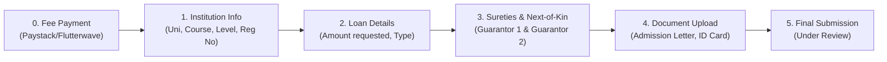
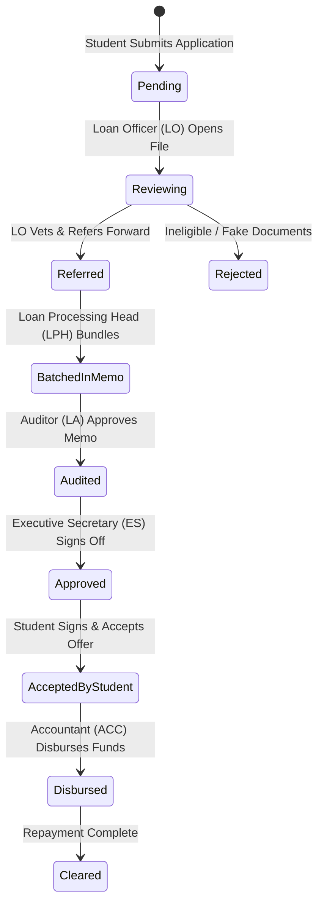
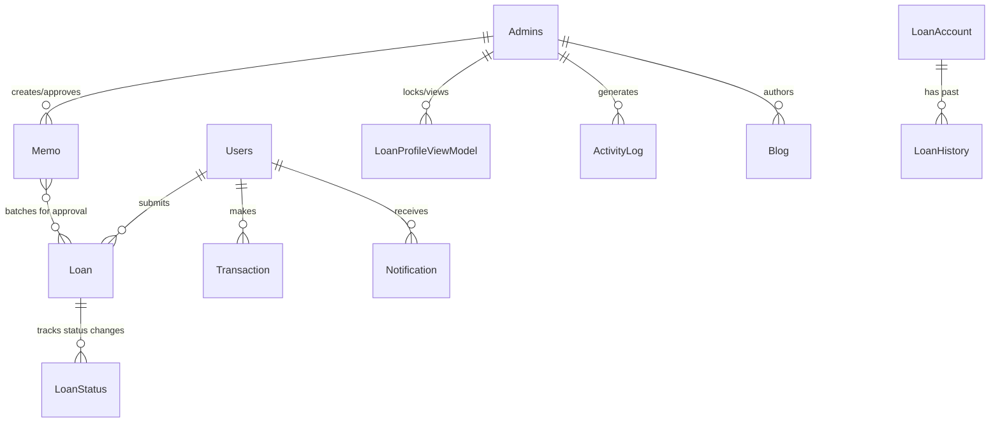

# Bayelsa State Higher Education Loans Board (BYHELB / BYSHELB)
## LMS Backend v2 — Comprehensive System & Codebase Map

> **Version:** 2.0.0  
> **Target Framework:** Node.js (v20.x) / Express.js 4.x  
> **Database:** MongoDB (Mongoose 6.x)  
> **API Specification:** Swagger / OpenAPI 2.0 (`/api-docs`)  

---

## 1. Executive Summary & Purpose

The **LMS Backend v2** is the central application and management backend for the **Bayelsa State Higher Education Loans Board (BYHELB / BYSHELB)**. It facilitates:
1. **Student Services**: Online portal for undergraduate and postgraduate tertiary students from Bayelsa State to create accounts, verify Bank Verification Numbers (BVN), pay application fees, upload verified academic and state-of-origin credentials, submit loan applications, and accept disbursement offers.
2. **Administrative Governance**: Multi-tier vetting and approvals by board officials (Loan Officers, Loan Processing Heads, Internal Auditors, and the Executive Secretary).
3. **Internal Approval Memo System**: Batching approved loans into internal memos that flow between officers, auditors, and executive decision-makers for fund disbursement.
4. **Legacy Loan History & Re-applicant Matching**: Linking previous loan disbursements to student profiles and supporting re-applications.
5. **Public Engagement**: Newsletters, public inquiries, portal status switch (open/close application portal), and blogging system.

---

## 2. High-Level System Architecture

```mermaid
flowchart TD
    subgraph Clients["Frontend Clients"]
        StudentFE["Student Portal (Next.js/React)"]
        AdminFE["Staff/Admin Dashboard (React)"]
        PublicFE["Public Portal / Website"]
    end

    subgraph Gateway["Server Entry & Middlewares (server.js & index.js)"]
        CORS["CORS Policy (Whitelist)"]
        BodyParse["Body Parser (5MB JSON/URLEncoded)"]
        Morgan["Morgan & Winston HTTP Logger"]
        Swagger["Swagger UI (/api-docs)"]
        Static["Public & EJS View Engine (/views)"]
    end

    subgraph Security["Auth & Guard Middlewares"]
        JWTAuth["Authentication.js (JWT & Custom Crypto)"]
        RBAC["Authorization.js (Role / Admin Role Checks)"]
        PortalGate["portalIsRequired (Global Portal Lock)"]
        Validator["Validator.js (Express-Validator & Yup)"]
    end

    subgraph Routing["Express Route Handlers (/routes)"]
        AuthRoutes["/api/v1/auth"]
        UserRoutes["/api/v1/users"]
        LoanRoutes["/api/v1/loans"]
        AdminLoanRoutes["/api/v1/re-applicant"]
        AdminRoutes["/api/v1/admin"]
        MemoRoutes["/api/v1/memos"]
        MessageRoutes["/api/v1/messages"]
        NotifyRoutes["/api/v1/notify"]
        NewsRoutes["/api/v1/newsletter"]
        BlogRoutes["/api/v1/blog"]
        MiscRoutes["/api/v1/misc"]
        InviteRoutes["/api/v1/invite"]
    end

    subgraph Logic["Controllers & Services"]
        LoanCtrl["Loan & AdminLoan Controllers"]
        AdminCtrl["Admin & Activity Controllers"]
        AuthCtrl["Auth & User Controllers"]
        MemoCtrl["Memo Controller"]
        Services["Domain Services (LoanHistory, Tokenizer, ViewLock)"]
    end

    subgraph Storage["Data & External Integrations"]
        MongoDB[("MongoDB Database")]
        PayGate["Payment Gateways (Paystack & Flutterwave)"]
        Cloudinary["Cloudinary Storage (Multer Documents)"]
        MailService["Mail Transport (SendGrid / Mailgun / Nodemailer)"]
    end

    Clients --> Gateway
    Gateway --> Security
    Security --> Routing
    Routing --> Logic
    Logic --> Storage
```



---

## 3. Directory & File Structure Map

```
lms-be-v2/
├── common/                          # Shared cross-cutting utility functions
│   ├── paginateReadMessages.js      # Pagination helper for message threads
│   └── safeParse.js                 # Safe JSON parser wrapper
│
├── config/                          # Central environment & constant configurations
│   ├── index.js                     # Secrets aggregator (process.env variables)
│   └── setting.js                   # Application enums (ROLES, LOAN_STATUS, CORS_WHITELISTS)
│
├── controllers/                     # Application request handlers & business logic
│   ├── ActivityController.js        # Audit trail logging and admin activity querying
│   ├── AdminController.js           # Admin authentication, staff invites, user management
│   ├── AdminLoanController.js       # Admin loan administration & re-applicant handlers
│   ├── AuthController.js            # Student registration, OTP verification, login, reset
│   ├── BlogController.js            # Public blog post creation, retrieval, updates
│   ├── LoanAccount.js               # BVN-based loan account record creation and lookup
│   ├── LoanController.js            # Core loan multi-step application & review endpoints
│   ├── LoanHistoryController.js     # Past loan disbursement historical records management
│   ├── LoanProfileViewController.js # Concurrency lock to prevent concurrent admin reviews
│   ├── MemoController.js            # Batch loan approval memos and internal routing
│   ├── MessageController.js         # Public user enquiries and response emails
│   ├── MiscController.js            # BVN KYC, bank account resolution, image uploads
│   ├── NewsLetterController.js      # Newsletter subscriptions and broadcasts
│   ├── NotificationController.js    # Internal platform notifications
│   └── UserController.js            # Student profile updates, onboarding status, banking info
│
├── logger/                          # Structured logging infrastructure (Winston)
│   ├── dev.loger.js                 # Console-oriented development logger
│   ├── production.logger.js         # MongoDB-backed Winston production logger
│   └── index.js                     # Environment-dependent logger selector
│
├── logs/                            # Local log output files (if enabled)
│
├── middlewares/                     # Express middleware pipeline
│   ├── Authentication.js            # JWT extraction & symmetric token payload decryption
│   ├── Authorization.js             # RBAC role guards, portal lock check, loan eligibility
│   ├── error.middleware.js          # Global 404 handler and 500 error response formatter
│   └── Validator.js                 # Request body validation schemas (express-validator)
│
├── models/                          # Mongoose ODM schemas & database models
│   ├── ActivityLog.js               # System-wide administrative action logs
│   ├── Admin.js                     # Staff accounts (ES, LO, LPH, Auditor, Acc, FDO, Blog)
│   ├── AdminActivity.js             # Admin session and login activities
│   ├── Blog.js                      # News and educational blog articles
│   ├── BlogCategory.js              # Categories for published articles
│   ├── Loan.js                      # Core loan application entity (undergrad/postgrad)
│   ├── loanAccount.js               # Bank-verified account identity record
│   ├── LoanHistory.js               # Historical disbursement records
│   ├── LoanProfileViewModel.js      # Active viewing lock record per loan profile
│   ├── LoanStatus.js                # State transition comments and timestamp audit
│   ├── Log.js                       # General log message entity
│   ├── Memo.js                      # Internal batch approval memos for loan workflows
│   ├── Message.js                   # Citizen enquiry messages and feedback
│   ├── NewsLetter.js                # Email newsletter subscribers
│   ├── Notification.js              # User-to-admin and admin-to-user notifications
│   ├── Page.js                      # System switch (loan portal open / closed state)
│   ├── ReApplicant.model.js         # Returning student applicant records
│   ├── Transaction.js               # Paystack / Flutterwave financial transactions
│   ├── User.js                      # Student / user profile accounts
│   ├── UserActivity.js              # Student session and portal activity logs
│   └── index.js                     # Mongoose connection initialization & Super Admin seed
│
├── routes/                          # API endpoint routing definitions
│   ├── adminLoanRoutes.js           # Re-applicant and admin loan review endpoints
│   ├── AdminRoutes.js               # Admin management, staff invite, portal switch routes
│   ├── AuthRoutes.js                # Student authentication & registration routes
│   ├── BlogRoutes.js                # Blog posts and CMS routes
│   ├── InviteRoutes.js              # Admin invitation acceptance link handler
│   ├── LoanRoutes.js                # Primary student loan application & review routes
│   ├── MemoRoutes.js                # Internal approval memo routing
│   ├── MessageRoutes.js             # Citizen contact messages and replies
│   ├── MiscRoutes.js                # Utility routes: bank verification, KYC, file upload
│   ├── NewsLetterRoutes.js          # Newsletter subscriptions and mailouts
│   ├── NotificationRoutes.js        # Internal notification feeds
│   └── UserRoutes.js                # Student personal profile and banking details
│
├── services/                        # Decoupled domain business logic & repositories
│   ├── ActivityLogeService.js       # Activity log persistence and query service
│   ├── LoanAccount.js               # Account entity creation and modification
│   ├── LoanHistoryService.js        # Historical loan data service
│   ├── LoanProfileViewService.js    # Concurrency lock service
│   ├── index.js                     # Services entry and repository bindings
│   ├── interface.js                 # Unified domain service interface contract
│   └── tokenizer/                   # Tokenization helpers
│
├── utils/                           # Helper utilities and external SDK integrations
│   ├── ActivityLogger.js            # Activity logging helper
│   ├── apiError.js                  # Custom HTTP error class (APIError)
│   ├── Bloc.js                      # Bloc API integration
│   ├── CheckEmail.js                # Email format verification helper
│   ├── Cloudinary.js                # Cloudinary image upload and configuration
│   ├── Email.js                     # Mail sending service (SendGrid, Mailgun, SMTP)
│   ├── Encryption.js                # Custom reversible base64/hex token encryption
│   ├── ExtractIdsFind.js            # MongoDB ID extraction helper
│   ├── ExtractValuesOfFieldInArray.js # Array manipulation helper
│   ├── FileUpload.js                # Multer configuration for image uploads
│   ├── Firebase.js                  # Firebase OTP and verification helper
│   ├── generateId.js                # Nanoid and random reference generators
│   ├── index.js                     # Aggregated utility exports
│   ├── Logger.js                    # Custom console logging wrapper
│   ├── LoginData.js                 # Client IP and user-agent metadata extractor
│   ├── Multer.js                    # Multer multipart storage engines
│   ├── PaymentFlutterwave.js        # Flutterwave SDK integration
│   ├── PaymentPaystack.js           # Paystack API integration
│   ├── PdfFileUpload.js             # Multer engine configured for PDF documents
│   ├── random.js                    # Random generator utils
│   ├── Response.js                  # Standardized JSON response wrapper (ResponseHelper)
│   ├── safeParse.js                 # JSON safe parse helper
│   └── seedData.js                  # Initial dummy/reference data
│
├── views/                           # Server-rendered EJS templates
│   └── emails/                      # Email notification templates
│       ├── admin_invite.ejs         # Staff invitation email
│       ├── login.ejs                # Login notification email
│       ├── newsletter.ejs           # Newsletter campaign template
│       ├── reply.ejs                # Support ticket reply email
│       ├── signup.ejs               # Student account OTP verification email
│       └── waitlist.ejs             # Waitlist confirmation email
│
├── .env                             # Environment configuration variables
├── api.yaml                         # OpenAPI 2.0 / Swagger documentation
├── constants.js                     # Legacy return types and notification definitions
├── index.js                         # Express application setup, middlewares, and route mounting
├── package.json                     # Node.js project manifest and dependency definitions
├── README.md                        # Project introductory readme
└── server.js                        # HTTP server entrypoint and database bootstrap
```

---

## 4. User Roles & Access Control (RBAC) Matrix

The system implements a dual-role authorization strategy:
- `role`: Broad classification (`student`, `es`, `lo`, `la`, `lph`, `acc`, `fdo`, `blog`).
- `admin_role`: Granular administrative rank stored in the `Admin` record.

### Staff Role Hierarchy

| Role Code | Role Name | Primary Responsibilities |
|---|---|---|
| `super_admin` / `es` | **Executive Secretary** | Final loan approval authority, staff invitations, account activations, and emergency toggle of loan portal (`open`/`close`). |
| `lph` | **Loan Processing Head** | Batches verified loan applications into internal **Memos** and routes them to Auditor and ES. |
| `la` | **Loan Auditor / Analyst** | Audits documentation, surety verification, and checks compliance before approving memos. |
| `lo` | **Loan Officer** | Initial vetting of submitted student applications; marks as `referred` or `rejected`. |
| `acc` | **Accountant** | Oversees financial disbursements and marks approved loans as `disbursed`. |
| `fdo` | **Front Desk Officer** | In-person student document ingestion and assistance. |
| `blog` | **Blogger / Communications** | Manages official news posts, press releases, and announcements. |
| `student` | **Student / Applicant** | Bayelsa State tertiary student; submits loan requests, uploads credentials, accepts offers. |

---

## 5. Core Business Workflows

### 5.1 Student Registration & Onboarding

```mermaid
sequenceDiagram
    autonumber
    actor S as Student
    participant Auth as Auth Controller
    participant Mail as Email Service
    participant DB as MongoDB
    participant BVN as Misc Controller (KYC)

    S->>Auth: POST /api/v1/auth/register (Name, Email, Password, BVN)
    Auth->>DB: Check uniqueness & hash password (bcrypt)
    Auth->>DB: Create User record (status: pending)
    Auth->>Mail: Send 6-digit OTP via signup.ejs template
    Auth-->>S: Return JWT token & prompt OTP
    S->>Auth: POST /api/v1/auth/verify_otp (token)
    Auth->>DB: Mark User status: activated
    S->>BVN: POST /api/v1/misc/kyc/bvn (Verify BVN with name)
    BVN-->>S: BVN matched & verified
    S->>Auth: PUT /api/v1/auth/create_account (Upload LGA cert, Birth cert, ID, Avatar)
    Auth->>DB: Set profile_completed: true
```



---

### 5.2 Multi-Stage Loan Application Workflow

Students apply through sequential stages. Before submitting form details, an application fee must be paid:



---

### 5.3 Multi-Tier Administrative Approval Pipeline

Loans pass through a state machine enforced by route guards and Memos:



---

### 5.4 Concurrency Prevention (Loan Profile View Lock)

To prevent multiple review officers from assessing or modifying the same student's application at the same time:
1. When an officer opens a loan, `POST /api/v1/admin/loan_account/details/view` creates a record in `LoanProfileView`.
2. If another officer attempts to access the profile while it is locked by another staff member, access is rejected.
3. When the officer leaves the profile, `DELETE /api/v1/admin/loan_account/details/view` frees the lock.

---

## 6. Complete API Route Map

### 6.1 Authentication Routes (`/api/v1/auth`)

| Method | Endpoint | Access | Description |
|---|---|---|---|
| `POST` | `/register` | Public | Student signup with basic info and BVN |
| `POST` | `/verify_otp` | Public | Verifies email verification code |
| `POST` | `/login` | Public | Student login returning encrypted JWT |
| `POST` | `/resend_verification_email` | Public | Re-transmits OTP to applicant |
| `POST` | `/forgot_password` | Public | Requests password reset email |
| `POST` | `/reset_password` | Public | Resets student account password |
| `PUT` | `/create_account` | `student` | Profile completion (LGA cert, birth cert, avatar, ID) |
| `GET` | `/user` | Authenticated | Retrieves current logged-in student profile |
| `PUT` | `/set_password` | Authenticated | Updates account password |

---

### 6.2 Loan Routes (`/api/v1/loans`)

| Method | Endpoint | Access | Description |
|---|---|---|---|
| `POST` | `/apply` | `student` | Initializes application fee payment |
| `POST` | `/verify_app_payment` | `student` | Verifies gateway payment reference |
| `GET` | `/` | Staff / Student | List loans |
| `GET` | `/user` | `student` | List all loans belonging to caller |
| `GET` | `/:loanId` | Authenticated | Fetch specific loan application details |
| `DELETE`| `/:loanId` | Authenticated | Remove loan application |
| `POST` | `/institution` | `student` | Submit undergraduate institution information |
| `PUT` | `/progress_stage` | `student` | Update current step in application wizard |
| `PUT` | `/others` | `student` | Submit loan financial details & requirements |
| `PUT` | `/guarantor_one` | `student` | Save first surety / guarantor information |
| `PUT` | `/guarantor_two` | `student` | Save second surety / guarantor information |
| `PUT` | `/document` | `student` | Upload admission letter, ID card, signed declaration |
| `PUT` | `/document/postgrads` | `student` | Upload postgraduate documents |
| `PUT` | `/document/reapply` | `student` | Upload re-application school fee receipts |
| `PUT` | `/document/guarantor` | `student` | Upload signed guarantor verification letters |
| `POST` | `/re-apply` | `student` | Submit re-application for continuing student |
| `POST` | `/accept_offer` | `student` | Formally accepts approved loan award |
| `GET` | `/admin/approved` | Admin Staff | View approved loans |
| `GET` | `/admin/rejected` | Admin Staff | View rejected loans |
| `GET` | `/admin/pending` | Admin Staff | View pending loans |
| `GET` | `/admin/disbursed` | Admin Staff | View disbursed loans |
| `GET` | `/admin/recent` | Admin Staff | View recently submitted loans |
| `PUT` | `/admin/status/update` | Admin Staff | Update loan status (LO / LPH / LA / ES) |
| `GET` | `/admin/analytics/board`| Admin Staff | Aggregated loan metrics and statistics |
| `GET` | `/admin/chart/board` | Admin Staff | Student distribution across Bayelsa LGAs |
| `PUT` | `/admin/disbursed_bulk`| Accountant | Bulk mark loans as disbursed |

---

### 6.3 Admin Administration Routes (`/api/v1/admin`)

| Method | Endpoint | Access | Description |
|---|---|---|---|
| `GET` | `/who_i_am` | Admin Staff | Get logged-in admin identity & permissions |
| `POST` | `/auth/invite` | ES / Super Admin | Invite new board staff member via email |
| `POST` | `/auth/create_password`| Invited Admin | Set password from invitation token |
| `POST` | `/auth/login` | Public Admin | Admin login returning JWT token |
| `PUT` | `/auth/accept_invite/:resetToken` | Invited Admin | Complete invitation onboarding |
| `POST` | `/auth/forgot_password`| Public Admin | Admin forgot password request |
| `POST` | `/auth/reset_password` | Public Admin | Admin reset password submission |
| `POST` | `/loan_account` | Admin Staff | Create BVN-backed loan account record |
| `GET` | `/loan_account` | Admin Staff | Search loan accounts by BVN / email / phone |
| `PUT` | `/loan_account` | Admin Staff | Update loan account details |
| `DELETE`| `/loan_account` | Admin Staff | Remove loan account |
| `POST` | `/loan_account/details` | Admin Staff | Create historical loan record |
| `GET` | `/loan_account/details` | Admin Staff | Search historical loan records |
| `PUT` | `/loan_account/details` | Admin Staff | Update historical loan entry |
| `DELETE`| `/loan_account/details` | Admin Staff | Delete historical loan record |
| `POST` | `/loan_account/details/view` | Admin Staff | Lock loan profile during review |
| `DELETE`| `/loan_account/details/view` | Admin Staff | Release loan profile lock |
| `GET` | `/users` | `es` (Super Admin) | List all registered student users |
| `GET` | `/users/:student` | Admin Staff | Fetch detailed profile of a student |
| `GET` | `/fetch_members` | Admin Staff | List all staff members and their roles |
| `PUT` | `/loan` | Admin Staff | Update loan details administratively |
| `GET` | `/` | Admin Staff | Get current admin user info |
| `PUT` | `/` | Admin Staff | Update personal admin profile |
| `PUT` | `/update_profile` | Admin Staff | Update admin contact information |
| `PUT` | `/update_password`| Admin Staff | Update admin password |
| `PUT` | `/update_avatar` | Admin Staff | Upload admin avatar picture |
| `PUT` | `/activate_staff` | `es` | Activate suspended staff member |
| `PUT` | `/deactivate_staff`| `es` | Deactivate/suspend staff member |
| `PUT` | `/portal/status` | `lph` / `es` | Open or close student loan application portal |
| `POST` | `/re-applicant` | Admin Staff | Find returning student records |

---

### 6.4 Approval Memo Routes (`/api/v1/memos`)

| Method | Endpoint | Access | Description |
|---|---|---|---|
| `POST` | `/create` | LPH | Create loan batch memo and forward to Auditor |
| `POST` | `/create/es` | Auditor / LA | Audit loan memo and forward to Executive Secretary |
| `POST` | `/create/others`| Staff | Create general internal staff memo |
| `GET` | `/sent` | Admin Staff | List memos dispatched by current officer |
| `GET` | `/received` | Admin Staff | List memos addressed to current officer |
| `GET` | `/unread` | Admin Staff | Get unread memos |
| `GET` | `/read` | Admin Staff | Get read memos |
| `GET` | `/view/:id/:th_id` | Admin Staff | View memo thread and attached loan batch |
| `GET` | `/sent/single-item/:id` | Admin Staff | Inspect single sent memo item |
| `GET` | `/disbursed` | Accountant | Retrieve memos cleared for disbursement |

---

### 6.5 User Profile Routes (`/api/v1/users`)

| Method | Endpoint | Access | Description |
|---|---|---|---|
| `GET` | `/` | Admin Staff | Fetch all student accounts |
| `GET` | `/who_i_am` | `student` | Fetch profile of current student |
| `PUT` | `/` | `student` | Update profile information |
| `PUT` | `/next_of_kin` | `student` | Update next-of-kin emergency contact |
| `PUT` | `/bank_details` | `student` | Update disbursement bank account details |
| `GET` | `/onboarding` | `student` | Inspect user registration/onboarding progress |

---

### 6.6 Miscellaneous, KYC & Media Routes (`/api/v1/misc`)

| Method | Endpoint | Access | Description |
|---|---|---|---|
| `GET` | `/banks` | Authenticated | List commercial banks supporting disbursement |
| `POST` | `/kyc/bvn` | Authenticated | Validate student Bank Verification Number (BVN) |
| `POST` | `/resolve_bank` | Authenticated | Resolve account number to bank account name |
| `POST` | `/upload` | Authenticated | Upload single image to Cloudinary |
| `GET` | `/portal-status` | Authenticated | Inspect whether loan portal is `open` or `close` |

---

### 6.7 Public Engagement & Community Routes

- **Messages (`/api/v1/messages`)**:
  - `POST /enquiry`: Public citizens submit support and inquiry requests.
  - `GET /`, `GET /unread`, `GET /read`, `GET /replied`: Staff ticket management.
  - `PUT /reply_message/:messageId`: Staff sends email response back to citizen.
- **Newsletter (`/api/v1/newsletter`)**:
  - `POST /subscribe`: Citizen newsletter signup.
  - `POST /send_message`: Admin broadcast email campaign.
  - `GET /count-subscribers`: Total count of active newsletter subscribers.
- **Blog (`/api/v1/blog`)**:
  - `GET /`: List published board news articles.
  - `GET /random-posts`: Featured and related news posts.
  - `GET /single/:blogUrl`: View article details by slug.
  - `POST /create-post`: Blogger creates new post with cover image.
  - `PUT /edit-post/:blogUrl`: Update blog post.
  - `DELETE /delete-post/:blogUrl`: Delete blog post.
- **Notifications (`/api/v1/notify`)**:
  - `POST /`: Send targeted notification.
  - `GET /`: Get current student notifications.
  - `GET /admin`: Get administrative staff alerts.

---

## 7. Database Entities & Relationships



### Key Models Overview

1. **Users (`models/User.js`)**: Students and applicants. Stores personal particulars, LGA, hometown, gender, BVN, identification documents, bank details, and next of kin.
2. **Admins (`models/Admin.js`)**: Staff members. Stores staff tier (`admin_role`), system role (`role`), push tokens, avatar, and activation state.
3. **Loan (`models/Loan.js`)**: The primary loan record. Contains loan type (`undergraduate`, `postgraduate`, `professional`), requested and repayment amounts, academic institution, sureties/guarantors, document URLs, review statuses (`lo_status`, `lph_status`, `auditor_status`, `es_status`), and student acceptance state.
4. **Memo (`models/Memo.js`)**: Internal approval workflow carrier. Holds a stringified batch of approved loans, routing between LPH, Auditor, and Executive Secretary.
5. **LoanAccount (`models/loanAccount.js`) & LoanHistory (`models/LoanHistory.js`)**: Historical repository of past disbursements used for re-application qualification and credit auditing.
6. **LoanProfileViewModel (`models/LoanProfileViewModel.js`)**: Concurrency lock mechanism preventing multiple reviewers from conflicting on the same application.
7. **Page (`models/Page.js`)**: System state singleton managing the global `loanPortal` (`open` / `close`) flag.

---

## 8. Security & Encryption Model

- **Password Hashing**: `bcryptjs` with salt work factor 10.
- **Symmetric Claims Obfuscation (`utils/Encryption.js`)**: Token claims (`user_id`, `user_email`, `role`, `admin`) are symmetrically obfuscated using double Base64-to-Hex transforms before signing inside JWT tokens to prevent token payload inspection on client devices.
- **Portal Gatekeeper (`middlewares/Authorization.js`)**: The `portalIsRequired` middleware dynamically blocks loan creation and modification endpoints if the `Page` document has `loanPortal: "close"`, while permitting administrative operations.
- **File Upload Protection**: Multer pipelines (`utils/FileUpload.js`, `utils/PdfFileUpload.js`) restrict upload sizes (5MB), validate file MIME types, and stream assets securely to Cloudinary storage buckets.

---

## 9. Environment Configuration Dictionary

| Variable | Description |
|---|---|
| `PORT` | HTTP server listening port (Default: `4000`) |
| `NODE_ENV` | Environment mode (`development`, `staging`, `production`) |
| `DATABASE_URL` | MongoDB connection URI string |
| `JWT_TOKEN` | Secret key used for signing and verifying JSON Web Tokens |
| `SUPER_ADMIN_EMAIL` | Default Super Admin / ES email seeded on first start |
| `SUPER_ADMIN_PASSWORD` | Default Super Admin / ES password seeded on first start |
| `ROLE` | Base system role constant |
| `SUPER_ADMIN_ROLE` | Executive Secretary admin role identifier (`es`) |
| `PAYSTACK_PUBLIC_KEY` | Paystack public API key for front-end SDKs |
| `PAYSTACK_SECRET_KEY` | Paystack secret key for server-side verification |
| `FLUTTERWAVE_PUBLIC_KEY`| Flutterwave public API key |
| `FLUTTERWAVE_SECRET_KEY`| Flutterwave secret key |
| `CLOUDINARY_CLOUD_NAME` | Cloudinary cloud identifier |
| `CLOUDINARY_API_KEY` | Cloudinary API key |
| `CLOUDINARY_API_SECRET` | Cloudinary API secret |
| `SENDGRID_KEY` | SendGrid mail delivery API key |
| `MAILGUN_KEY` | Mailgun mail delivery API key |
| `MAILGUN_DOMAIN` | Mailgun authorized sending domain |
| `USER_FRONTEND_URL` | Origin URL for the student-facing portal |
| `ADMIN_FRONTEND_URL` | Origin URL for the staff/admin dashboard |

---

## 10. Developer Quickstart

### Prerequisites
- Node.js 20.x or higher
- MongoDB instance (Local or Atlas)
- Yarn or NPM

### Setup & Run
```bash
# 1. Install dependencies
npm install

# 2. Run in development mode (with nodemon reload)
npm run dev

# 3. Access Swagger API Documentation
# Open in browser: http://localhost:4000/api-docs
```
