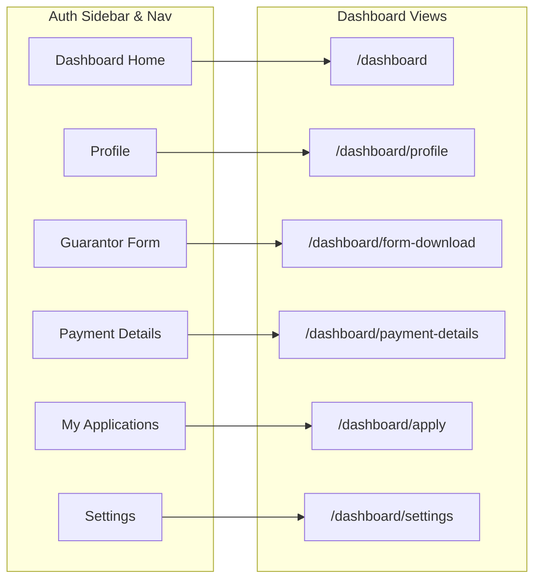
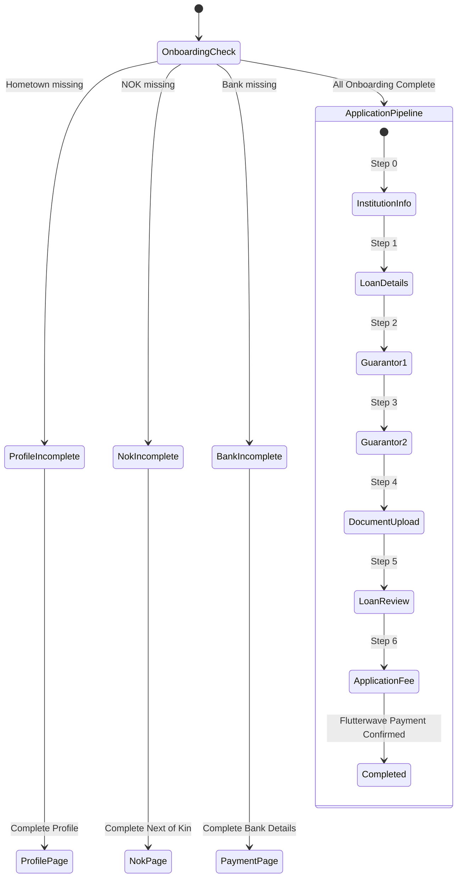

# BYSHELB (Bayelsa State Higher Education Loan Board) - Site Map & Route Architecture

This document maps all pages, routes, application workflows, access controls, layouts, and core components for the **BYSHELB Student Loan Portal** (`lms-fe-v2`).

---

## 1. High-Level Site Hierarchy

```mermaid
flowchart TD
    Root["/ (Application Root)"]

    %% Public Section
    Root --> PublicRoutes["Public & Marketing Routes"]
    PublicRoutes --> Home["/ (Home Page)"]
    PublicRoutes --> About["/about (About BYSHELB)"]
    PublicRoutes --> FAQs["/faqs (Frequently Asked Questions)"]
    PublicRoutes --> Contact["/contact (Contact Us)"]
    PublicRoutes --> Blog["/blog (News & Articles)"]
    Blog --> SinglePost["/blog/posts/:title/:id (Article Detail)"]

    %% Auth Section
    Root --> AuthRoutes["Authentication Routes"]
    AuthRoutes --> Login["/login (Sign In)"]
    AuthRoutes --> Signup["/signup (Create Account Flow)"]
    AuthRoutes --> ForgotPass["/forgot-password (Request Password Reset)"]
    AuthRoutes --> ResetPass["/reset-password (Set New Password)"]

    %% Protected Section
    Root --> ProtectedDashboard["/dashboard (Protected Student Area)"]
    
    ProtectedDashboard --> DashHome["/dashboard (Dashboard Overview)"]
    ProtectedDashboard --> Profile["/dashboard/profile (Student Profile)"]
    ProtectedDashboard --> NOK["/dashboard/next-of-kin (Next of Kin Details)"]
    ProtectedDashboard --> FormDownload["/dashboard/form-download (Guarantor Form PDF)"]
    ProtectedDashboard --> PaymentDetails["/dashboard/payment-details (Disbursement Bank Account)"]
    ProtectedDashboard --> Settings["/dashboard/settings (Security & BVN)"]
    ProtectedDashboard --> Logout["/dashboard/logout (Session Termination)"]
    
    %% Loan Workflows
    ProtectedDashboard --> Applications["/dashboard/apply (My Applications Table)"]
    Applications --> AppDetail["/dashboard/apply/details/:id (Loan Review & Files)"]
    
    ProtectedDashboard --> UndergradApply["/dashboard/apply/undergraduate (Undergraduate Entry)"]
    UndergradApply --> UndergradSteps["/dashboard/apply/undergraduate/:id (7-Step Wizard)"]
    
    ProtectedDashboard --> PostgradSteps["/dashboard/apply/postgraduate (Postgraduate Flow)"]
    ProtectedDashboard --> ProfSteps["/dashboard/apply/professional (Professional Loan Flow)"]

    %% Fallback
    Root --> NotFound["* (404 Error Page)"]
```



---

## 2. Route Specifications & Inventory

### 2.1 Public Pages (Marketing & Information)

| Route Path | Page Title | Component File | Layout | Description |
| :--- | :--- | :--- | :--- | :--- |
| `/` | Home | [`src/pages/index.jsx`](src/pages/index.jsx) | `MainLayout` | Landing page featuring hero banners, loan schemes overview, news highlights, and newsletter subscription. |
| `/about` | About Us | [`src/pages/About.jsx`](src/pages/About.jsx) | `UniqueLayout` | Brand story, mission, leadership, and board members of BYSHELB. |
| `/faqs` | FAQs | [`src/pages/Faq.jsx`](src/pages/Faq.jsx) | `MainLayout` | Frequently asked questions regarding loan qualification, tenure, repayment, and guarantor requirements. |
| `/contact` | Contact Us | [`src/pages/contact.jsx`](src/pages/contact.jsx) | `MainLayout` | Support channels, inquiry form, contact address, and agency telephone lines. |
| `/blog` | Blog & News | [`src/pages/Blog.jsx`](src/pages/Blog.jsx) | `MainLayout` | Articles, announcements, and press releases regarding loan distributions and education reforms. |
| `/blog/posts/:title/:id` | Article Details | [`src/pages/SingleNewsBlogPage.jsx`](src/pages/SingleNewsBlogPage.jsx) | `MainLayout` | Full article view with dynamic parameter reading (`title`, `id`). |
| `*` | 404 Not Found | [`src/pages/ErrorPage.jsx`](src/pages/ErrorPage.jsx) | Standalone | Fallback route for broken or non-existent URLs. |

---

### 2.2 Authentication & Account Recovery

| Route Path | Page Title | Component File | Access Rule | Features & Multi-Step Views |
| :--- | :--- | :--- | :--- | :--- |
| `/login` | Sign In | [`src/pages/Login.jsx`](src/pages/Login.jsx) | Guest only (redirects to `/dashboard` if logged in) | Email/password sign-in, JWT token handling, remember me, link to password recovery. |
| `/signup` | Create Account | [`src/pages/signup.jsx`](src/pages/signup.jsx) | Guest only (redirects to `/dashboard` if logged in) | Multi-step registration:<br/>1. `CreateAccountEmail`<br/>2. `VerifyOtp` |
| `/forgot-password` | Forgot Password | [`src/components/Auth/ForgetPassword/index.jsx`](src/components/Auth/ForgetPassword/index.jsx) | Public / Guest | Form to submit registered email and request reset link/code. |
| `/reset-password` | Reset Password | [`src/components/Auth/ForgetPassword/ResetPassword.jsx`](src/components/Auth/ForgetPassword/ResetPassword.jsx) | Public / Guest | Form to enter new password with token validation. |

---

### 2.3 Protected Student Dashboard (`/dashboard`)

All subroutes are wrapped inside [`AuthNav`](src/components/AuthNav/index.jsx), enforcing token authentication, top navigation, and mobile menu drawer. Pages utilize [`AuthLayout`](src/layout/AuthLayout.jsx) for the desktop sidebar.



| Dashboard Route | Screen Name | Component | Access / Guard | Description |
| :--- | :--- | :--- | :--- | :--- |
| `/dashboard` | Dashboard Home | [`src/pages/dashboard/index.jsx`](src/pages/dashboard/index.jsx) | Authenticated | Overview with program selector (Undergraduate, Postgraduate), onboarding checklist check, recent loan history. |
| `/dashboard/profile` | Profile | [`src/pages/dashboard/Profile.jsx`](src/pages/dashboard/Profile.jsx) | Authenticated | Personal details management (Name, Gender, LGA of origin, Hometown, Phone, Address, Passport upload). |
| `/dashboard/next-of-kin` | Next of Kin | [`src/pages/dashboard/NextOfKinPage.jsx`](src/pages/dashboard/NextOfKinPage.jsx) | Authenticated | Next-of-Kin profile form (Full name, relationship, address, phone number). |
| `/dashboard/form-download` | Guarantor Form | [`src/pages/dashboard/downloadform.jsx`](src/pages/dashboard/downloadform.jsx) | Authenticated | Downloadable official BYSHELB Guarantor PDF document and checklist of requirements. |
| `/dashboard/payment-details`| Bank & Payment Details | [`src/pages/dashboard/payment.jsx`](src/pages/dashboard/payment.jsx) | Authenticated | Disbursement bank details: bank selection list (`/misc/banks`), account number verification via BVN/NIP (`/misc/resolve_bank`). |
| `/dashboard/settings` | Account Settings | [`src/pages/dashboard/settings.jsx`](src/pages/dashboard/settings.jsx) | Authenticated | Tabbed configuration:<br/>1. Password change form (`old_password`, `password`, `confirm_password`)<br/>2. BVN verification / linking. |
| `/dashboard/logout` | Session Logout | [`src/pages/dashboard/Logout/index.jsx`](src/pages/dashboard/Logout/index.jsx) | Authenticated | Clears `sessionStorage`, resets MobX auth state, and redirects to `/`. |

---

### 2.4 Loan Applications & Multi-Step Pipelines

Students must pass the **3-step onboarding checkpoint** before entering the loan application pipeline:



#### Application Subroutes:

| Route Path | Component File | Description & Sub-components |
| :--- | :--- | :--- |
| `/dashboard/apply` | [`src/pages/dashboard/apply.jsx`](src/pages/dashboard/apply.jsx) | Table of existing loan applications with status tracking via [`LoanTable`](src/components/table/index.jsx). |
| `/dashboard/apply/details/:id` | [`src/components/Dashboard/Apply/LoanDetails/index.jsx`](src/components/Dashboard/Apply/LoanDetails/index.jsx) | Inspection view for a single application with document viewer and status logs. |
| `/dashboard/apply/undergraduate` | [`src/components/Dashboard/Apply/UndergraduateLoan/UndergraduateApplication.jsx`](src/components/Dashboard/Apply/UndergraduateLoan/UndergraduateApplication.jsx) | Initial institution selection and enrollment verification form. |
| `/dashboard/apply/undergraduate/:id` | [`src/components/Dashboard/Apply/UndergraduateLoan/index.jsx`](src/components/Dashboard/Apply/UndergraduateLoan/index.jsx) | 7-Step undergraduate application wizard wrapped in `UndergraduateLoanStepProvider`:<br/>• Step 0: `InstitutionInfoPage`<br/>• Step 1: `LoanComp` (Amount & details)<br/>• Step 2: `GuarantorForm` (Guarantor 1)<br/>• Step 3: `GuarantorFormTwo` (Guarantor 2)<br/>• Step 4: `UndergraduateForm` (Document uploads)<br/>• Step 5: `LoanDetailReview`<br/>• Step 6: `AppFee` (Flutterwave integration) |
| `/dashboard/apply/postgraduate` & `/:id` | [`src/components/Dashboard/Apply/PostgraduateLoan/index.jsx`](src/components/Dashboard/Apply/PostgraduateLoan/index.jsx) | Multi-step postgraduate pipeline (`InstitutionInfoPage`, `LoanComp`, `GuarantorForm`, `GuarantorFormTwo`, `PostGraduateForm`, `GuarantorFormFile`, `AppFee`). |
| `/dashboard/apply/professional` & `/:id` | [`src/components/Dashboard/Apply/ProfessionalLoan/index.jsx`](src/components/Dashboard/Apply/ProfessionalLoan/index.jsx) | Multi-step professional loan pipeline (`InstitutionInfoPage`, `LoanComp`, `GuarantorForm`, `GuarantorFormTwo`, `ProfessionalFormDoc`, `GuarantorFormFile`, `AppFee`). |

---

## 3. Layout Structure

```
App.jsx (BrowserRouter, Toaster, GlobalStyles)
│
├── MainLayout (Navbar + Footer + Newsletter)
│   ├── / (HomePage)
│   ├── /faqs (FaqPage)
│   ├── /contact (ContactPage)
│   ├── /blog (BlogPage)
│   └── /blog/posts/:title/:id (SingleNewsBlogPage)
│
├── UniqueLayout (UniqueNavbar + Footer)
│   └── /about (AboutPage)
│
├── Standalone / Unwrapped
│   ├── /login (LoginPage)
│   ├── /signup (SignupPage)
│   ├── /forgot-password (ResetPassPage)
│   ├── /reset-password (ResetPassword)
│   └── * (Error404Page)
│
└── AuthNav (TopBar + Mobile Drawer + Auth Guard)
    └── AuthLayout (Sidebar + Main Content Container)
        ├── /dashboard (DashboardPage)
        ├── /dashboard/profile (ProfilePage)
        ├── /dashboard/next-of-kin (NOKPage)
        ├── /dashboard/form-download (DownloadForm)
        ├── /dashboard/payment-details (PaymentPage)
        ├── /dashboard/settings (SettingsPage)
        ├── /dashboard/logout (LogoutPage)
        ├── /dashboard/apply (ApplyLoanPage)
        ├── /dashboard/apply/details/:id (LoanDetailsComp)
        ├── /dashboard/apply/undergraduate (UndergraduateApplication)
        ├── /dashboard/apply/undergraduate/:id (UnderGraduateLoan)
        ├── /dashboard/apply/postgraduate (PostGraduateLoan)
        └── /dashboard/apply/professional (ProfessionalLoanPage)
```

---

## 4. API Endpoint Integration Map

Backend endpoints referenced by frontend services and routes (`src/routes/apirRoutes.js`):

| API Endpoint | HTTP Method | Interacting Frontend Views |
| :--- | :--- | :--- |
| `/auth/login` | POST | `/login` ([`LoginComponent`](src/components/Auth/Login/index.jsx)) |
| `/auth/register` | POST | `/signup` ([`CreateAccountEmail`](src/components/Auth/CreateAcoount/CreateAccountEmail.jsx)) |
| `/users/who_i_am` | GET | `AuthNav`, `ProfilePage`, `UnderGraduateLoan`, `PostGraduateLoan` |
| `/users/onboarding` | GET | Onboarding status verification across `/dashboard` |
| `/users/next_of_kin` | POST/PUT | `/dashboard/next-of-kin` ([`NextOfKinPage`](src/components/Dashboard/Apply/NextOfKinPage.jsx)) |
| `/users/bank_details` | POST/PUT | `/dashboard/payment-details` ([`PaymentDetailsComp`](src/components/Dashboard/Apply/PaymentDetailsComp.jsx)) |
| `/loans/user` | GET | `/dashboard` overview, `/dashboard/apply` table |
| `/loans/institution` | POST | `/dashboard/apply/undergraduate` ([`InstitutionForm`](src/components/Dashboard/Apply/InstitutionForm.jsx)) |
| `/loans/:id` | GET/PUT | Loan step progress, guarantor details, document uploads |
| `/misc/banks` | GET | List of commercial banks for disbursement account setup |
| `/misc/resolve_bank` | POST | Real-time NIP account resolution by account number & bank code |
