# SecureSync - Site Map & System Architecture

## 1. Project Overview

**SecureSync** (`secure-sync-js`) is a full-featured secure cloud storage and document management web application. It enables users to upload, preview, organize, download, and securely share files with granular access control, alongside multi-factor authentication (2FA) and storage quota tracking.

- **Frontend Core:** React 18 (Vite)
- **Routing:** React Router DOM v6 (`createBrowserRouter`)
- **State Management:** Redux Toolkit (`@reduxjs/toolkit`), `react-redux`, `redux-persist`
- **Data Fetching / API:** Redux Toolkit Query (RTK Query) with automatic 401 token refresh
- **Styling:** Tailwind CSS, PostCSS, Lucide React, React Icons
- **Document Rendering:** `@cyntler/react-doc-viewer`, `react-file-viewer`
- **Forms & Validation:** `react-hook-form`, Yup, `@hookform/resolvers`
- **Backend API:** RESTful API running at `https://secure-sync.onrender.com/api/v1`

---

## 2. Visual Site Architecture

```mermaid
flowchart TD
    classDef public fill:#1e293b,stroke:#38bdf8,stroke-width:1px,color:#fff;
    classDef protected fill:#0f172a,stroke:#34d399,stroke-width:2px,color:#fff;
    classDef modal fill:#334155,stroke:#f59e0b,stroke-width:1px,stroke-dasharray: 4 2,color:#fff;
    classDef api fill:#111827,stroke:#a855f7,stroke-width:1px,color:#fff;

    Root["/ (Root Layout)"]:::public

    %% Public Routes
    Root --> Home["/ (Home Landing)"]:::public
    Root --> About["/about (About Us)"]:::public
    Root --> Contact["/contact (Contact Us)"]:::public
    Root --> SignIn["/sign-in (Authentication)"]:::public
    Root --> SignUp["/sign-up (Registration)"]:::public
    Root --> Verify["/verify (OTP Verification)"]:::public
    Root --> ForgotPwd["/forget-password (Password Recovery)"]:::public
    Root --> PublicView["/view?ref=:id (Public Doc Viewer)"]:::public
    Root --> NotFound404["* (404 Page)"]:::public

    %% Protected Boundaries
    Root -. Protected Route .-> DriveLayout["/drive (Drive Dashboard)"]:::protected
    Root -. Protected Route .-> ProfilePage["/profile (User Profile & Security)"]:::protected

    %% Drive Subroutes
    DriveLayout --> DriveAll["/drive (All Files)"]:::protected
    DriveLayout --> DriveDocs["/drive/docs (Documents)"]:::protected
    DriveLayout --> DrivePhoto["/drive/photo (Photos)"]:::protected
    DriveLayout --> DriveShared["/drive/shared (Shared Files)"]:::protected
    DriveLayout --> DriveTrash["/drive/trash (Trash / Bin)"]:::protected
    DriveLayout --> DriveFileView["/drive/view (In-App Document Viewer)"]:::protected

    %% Modal Dialogs
    DriveLayout -. Opens .-> ModUpload["Upload Modal"]:::modal
    DriveLayout -. Opens .-> ModShare["Share Modal (View/Download)"]:::modal
    DriveLayout -. Opens .-> ModUnshare["Unshare / Revoke Modal"]:::modal
    DriveLayout -. Opens .-> ModDelete["Permanent Delete Modal"]:::modal
    DriveLayout -. Opens .-> ModTrash["Move to Trash Modal"]:::modal
    DriveLayout -. Opens .-> ModRestore["Restore Trash Modal"]:::modal
    DriveLayout -. Opens .-> ModInvite["Invite Team Member Modal"]:::modal
    DriveLayout -. Opens .-> ModShareUrl["Share Link Generator Modal"]:::modal
    DriveLayout -. Opens .-> ModProfile["Profile Quick Menu"]:::modal
    DriveLayout -. Opens .-> ModLogout["Logout Confirmation"]:::modal

    %% Backend Services
    DriveLayout & ProfilePage & SignIn & PublicView -. RTK Query .-> BackendAPI["Render REST API (/api/v1)"]:::api
```

---

## 3. Site Navigation & Route Registry

All routes are registered in `src/routes/index.jsx`.

### 3.1 Public Marketing & Authentication Routes
*Layout:* `src/ui/app-layout/index.jsx` (Includes `Header`, `Footer`, `ProfileModal`, `Logout`)

| Route Path | Component | Auth Required | Description |
| :--- | :--- | :--- | :--- |
| `/` | `src/pages/home/index.jsx` | No | Landing page highlighting encryption, intuitive UI, granular sharing, and activity tracking. |
| `/about` | `src/pages/about/index.jsx` | No | Company background, security principles, and product capabilities. |
| `/contact` | `src/pages/contact/index.jsx` | No | User inquiry and feedback submission form. |
| `/sign-in` | `src/pages/sign-in/index.jsx` | No | Login portal with email/password and automated 2FA challenge fallback. |
| `/sign-up` | `src/pages/sign-up/index.jsx` | No | User registration with input validation. |
| `/verify` | `src/pages/verify-user/index.jsx` | No | Email OTP verification featuring live timer and resend capability. |
| `/forget-password` | `src/pages/forgot-password/index.jsx`| No | Multi-step recovery workflow (request OTP, verify OTP, update password). |
| `/view` | `src/pages/public-view/index.jsx` | No (Token-based) | Public-facing document preview rendered via `?ref=<file_id>`. |
| `*` | `src/pages/not-found/index.jsx` | No | Fallback 404 page for unmatched routes. |

---

### 3.2 Authenticated Drive Routes
*Layout:* `src/ui/drive-layout/index.jsx` (Guarded by `ProtectedRoute`)  
*Header:* `src/ui/drive-header/index.jsx` (Debounced search bar, invite member button, avatar menu)  
*Sidebar:* `src/ui/side-bar/index.jsx` (Quick navigation and dynamic storage quota progress indicator)

| Route Path | View Param | Component | Filter / Purpose |
| :--- | :--- | :--- | :--- |
| `/drive` | `undefined` | `src/ui/drive-content/index.jsx` | Displays all files owned by the user. |
| `/drive/docs` | `docs` | `src/ui/drive-content/index.jsx` | Filters files matching documents (`pdf`, `doc`, `docx`, `xls`, `xlsx`, `ppt`, `pptx`). |
| `/drive/photo` | `photo` | `src/ui/drive-content/index.jsx` | Filters files matching image formats (`png`, `jpeg`, `jpg`). |
| `/drive/shared` | `shared` | `src/ui/drive-content/index.jsx` | Displays files shared with other members or shared with the user. |
| `/drive/trash` | `trash` | `src/ui/drive-content/index.jsx` | Displays soft-deleted files with options to restore or permanently remove. |
| `/drive/view` | `view` | `src/pages/view/index.jsx` | Full-screen document viewer for authenticated users with pagination and zoom controls. |

---

### 3.3 Account & Security Management
*Route:* `/profile`  
*Component:* `src/pages/profile/index.jsx` (Guarded by `ProtectedRoute`)

- **Profile Picture:** Upload and update avatar to Cloudinary via `PATCH /user/profile`.
- **Two-Factor Authentication:** Toggle switch to enable/disable 2FA via `PATCH /user/update-2fa`.
- **Change Password:** Password update form via `PATCH /auth/reset-password`.

---

## 4. Modal System & Actions

Defined in `src/shared/constants/index.js` and managed through `src/components/modal/modal.jsx`:

| Modal Constant (`MODALS_ID`) | Component | Functionality |
| :--- | :--- | :--- |
| `UPLOAD` (`modals/upload`) | `src/ui/drive-upload/index.jsx` | Drag-and-drop file upload dialog supporting batch uploads. |
| `SHARE` (`modals/share`) | `src/ui/file-share/index.jsx` | Share selected file with another user via email with view/download permissions. |
| `UNSHARE` (`modals/unshare`) | `src/ui/file-un-share/index.jsx` | Revoke access permissions for a shared document. |
| `PUBLIC_URL` (`modals/public-url`) | `src/ui/display-file-share/index.jsx` | Displays generated link for external file sharing. |
| `DELETE` (`modals/delete`) | `src/ui/file-delete/index.jsx` | Permanent deletion confirmation dialog. |
| `TRASH` (`modals/trash`) | `src/ui/file-trash/index.jsx` | Moves active files into the trash bin. |
| `RESTORE` (`modals/restore-trash`)| `src/ui/file-restore/index.jsx` | Restores files from the trash back to active storage. |
| `INVITE` (`modals/invite`) | `src/ui/invite-user/index.jsx` | Sends email invitations to new team members. |
| `PROFILE` (`modals/profile`) | `src/components/profile-modal/index.jsx`| Quick navigation menu to Profile, Drive, or Logout. |
| `LOGOUT` (`modals/logout`) | `src/ui/logout/logout.jsx` | Clears credentials, cookies, and local sessions upon confirmation. |

---

## 5. Global State Management (Redux)

Configured in `src/redux/index.js`:

1. **`fileState` (`src/redux/slice/file-slice.js`):**
   - Tracks file selection mode (`selecting`, `selected`).
   - Active search string (`search`).
   - Active documents loaded into the viewer (`docs`, `activeDoc`).
   - Shareable link buffer (`shareUrl`).
2. **`userState` (`src/redux/slice/user-slice.js`):**
   - User profile data, authentication state, and session tokens.
3. **`loadingState` (`src/redux/slice/loading-slice.js`):**
   - Global loading overlay and spinner controls.

---

## 6. Backend API Integration (RTK Query)

Configured in `src/api/index.js` with automatic JWT Bearer authorization and token rotation on `401 Unauthorized`:

### Authentication Endpoints (`src/api/auth-endpoints.js`)
- `POST /auth/register` - Create account
- `POST /auth/login` - Authenticate user
- `POST /auth/logout` - Invalidate session
- `POST /auth/check` - Verify active authentication token
- `POST /auth/email-otp` - Request email verification code
- `POST /auth/renew-otp` - Resend verification code
- `POST /auth/verify-otp` - Confirm verification code
- `POST /auth/verify-2fa` - Two-factor authentication validation
- `PATCH /auth/reset-password` - Update account password

### File & Storage Endpoints (`src/api/file-endpoints.js`)
- `GET /resources/upload` - Fetch all user files
- `POST /resources/upload` - Upload new file(s)
- `DELETE /resources/upload?id=:id` - Hard delete file
- `PUT /resources/upload/trash?id=:id` - Soft delete file (move to trash)
- `PUT /resources/upload/restore_trashed?id=:id` - Restore trashed file
- `GET /resources/upload/trash` - Fetch trashed files
- `POST /resources/upload/share` - Share file with user
- `PATCH /resources/upload/unshare` - Revoke shared file access
- `GET /resources/upload/shared` - Fetch all shared files
- `GET /resources/storage` - Storage space metrics (used vs total)
- `GET /resources/upload/view?id=:id` - Retrieve single file details for authenticated viewing
- `GET /resources/view?ref=:id` - Public file access by reference ID

### User Endpoints (`src/api/user-endpoints.js`)
- `POST /user/invite` - Send member invitation
- `POST /user/recovery-mail?email=:email` - Initiate password recovery email
- `GET /user/verify-reset?otp=:otp&email=:email` - Validate reset token
- `POST /user/reset-password` - Finalize password reset
- `PATCH /user/update-2fa` - Toggle two-factor authentication
- `PATCH /user/profile` - Upload avatar image
