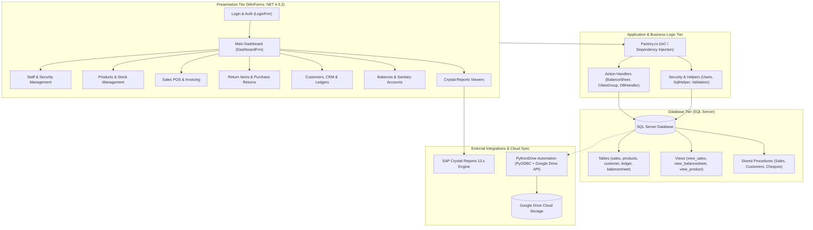

# MM Traders Inventory Management System — System & Application Map

## 1. System Overview

The **MM Traders Inventory System** is an enterprise-grade Windows desktop ERP and inventory management solution built with C# and the .NET Framework (v4.5.2). It provides point-of-sale (POS) billing, multi-brand inventory tracking, customer and supplier ledger management, sanitary accounts reconciliation, Crystal Reports analytics, and automated cloud backups to Google Drive.

---

## 2. Navigation Sitemap & Screen Hierarchy

The diagram below maps the complete user flow from launch (`Program.cs`) through the main dashboard and into every operational screen:

```mermaid
flowchart TD
    Boot(["Program.cs (Culture: en-PK)"]) --> Login["LoginFrm.cs"]
    
    Login -->|"Forgot Password"| Forgot["ForgotPassword / ResetForgotenPassFrm"]
    Login -->|"Database Missing"| DBCreate["Auto-Create via Script.sql"]
    Login -->|"Authentication Success"| Dash["DashboardFrm.cs (Main Workspace)"]

    %% Staff Subsystem
    Dash -->|"Staff Menu (Admin Only)"| StaffMenu{"Staff Menu"}
    StaffMenu --> Staff_Add["RegistrationFrm.cs (Add Staff)"]
    StaffMenu --> Staff_View["StaffFrm.cs (View Staff)"]
    Staff_View --> Staff_Perm["Permissions.cs (RBAC Setup)"]
    StaffMenu --> Staff_Logs["UserLogFrm.cs (Audit Trail)"]
    StaffMenu --> Staff_Reset["ResetLoginFrm.cs (Change Password)"]
    StaffMenu --> Staff_Rcpt["SetReceiptrm.cs (Configure POS Receipt)"]

    %% Products Subsystem
    Dash -->|"Products Menu"| ProdMenu{"Products Menu"}
    ProdMenu --> Prod_Add["ProductRegistrationFrm.cs"]
    Prod_Add --> Prod_Cat["CategoryFrm.cs (Brand Setup)"]
    ProdMenu --> Prod_Stock["StockManagementFrm.cs"]
    Prod_Stock --> Prod_Bulk["BulkStockUpdate.cs"]
    Prod_Stock --> Prod_Import["StockBulkInsertFrm.cs"]
    Prod_Stock --> Prod_Update["UpdateStockFrm.cs"]

    %% Sales Subsystem
    Dash -->|"Sales Menu"| SalesMenu{"Sales Menu"}
    SalesMenu --> Sale_New["SalesFrm.cs (Make Sale / POS)"]
    Sale_New --> Sale_CustAdd["RegisterCustomer.cs (Quick Add)"]
    Sale_New --> Sale_Print["ReceiptFrm.cs (Thermal Print)"]
    SalesMenu --> Sale_View["SalesInformationFrm.cs (Sales History)"]
    Sale_View --> Sale_Items["ItemsViewFrm.cs (Inspect Items)"]
    Sale_View --> Sale_RetPurch["ReturnPurchaseFrm.cs"]
    SalesMenu --> Sale_RetSale["SalesFrm.cs (Return Mode)"]
    SalesMenu --> Sale_RetAudit["ReturneditemsMgtFrm.cs"]

    %% Customers Subsystem
    Dash -->|"Customers Menu"| CustMenu{"Customers Menu"}
    CustMenu --> Cust_Mgmt["CustomerManagementFrm.cs"]
    Cust_Mgmt --> Cust_Assign["Assigment.cs (Route Setup)"]
    Cust_Mgmt --> Cust_Cheque["ChequePaymentFrm.cs"]
    CustMenu --> Cust_Ledger["LedgerFrm.cs (Customer Ledger)"]
    CustMenu --> Cust_Stmt["CusomerStatementFrm.cs"]
    CustMenu --> Cust_Bal["BalanceManagement.cs & BalanceSheet.cs"]

    %% Sanitary & Accounting Subsystem
    Dash -->|"Sanitary & Accounts"| AcctMenu{"Sanitary Accounts"}
    AcctMenu --> Acct_Sanitary["Sanitary_Accounts.cs"]
    AcctMenu --> Acct_Trans["ViewTransactions.cs"]
    AcctMenu --> Acct_Groups["Groups.cs & CityGroups.cs"]

    %% Configuration & Maintenance
    Dash -->|"Configuration Menu"| ConfMenu{"Configuration"}
    ConfMenu --> Conf_Conn["DBConfigurationFrm.cs (SQL Server Config)"]
    ConfMenu --> Conf_Backup["DBBackupFrm.cs (Local Backup/Restore)"]
    Dash -.->|"Timer Limit Trigger"| Conf_Act["ActivationFrm.cs (License Check)"]
```

---

## 3. Comprehensive Form & Screen Directory

| Screen / Form | Source File | Module | Security Privilege | Purpose & Linkages |
| :--- | :--- | :--- | :--- | :--- |
| **LoginFrm** | `API\User_Security\Loginfrm.cs` | Security | Public | System login, SQL connectivity check, first-run database creation prompt. |
| **ForgotPassword** | `API\User_Security\ForgotPassword.cs` | Security | Public | Credential reset utility when user loses access. |
| **ResetForgotenPassFrm** | `API\User_Security\ResetForgotenPassFrm.cs` | Security | Public | Reset password verification form. |
| **DashboardFrm** | `API\DashboardFrm.cs` | Core | Authenticated | Main MDI shell hosting clocks, user identity status, license watcher, and toolstrip menus. |
| **RegistrationFrm** | `API\RegistrationFrm.cs` | Staff | Admin (RoleID = 1) | Create new user login accounts and staff profiles. |
| **StaffFrm** | `API\StaffFrm.cs` | Staff | Admin (RoleID = 1) | Manage staff records and open the permissions editor. |
| **Permissions** | `API\User_Security\Permissions.cs` | Staff | Admin (RoleID = 1) | Checkbox matrix to assign granular permission codes to users. |
| **UserLogFrm** | `API\User_Security\UserLogFrm.cs` | Staff | Admin (RoleID = 1) | Audit trail of user logins, logouts, and system events. |
| **ResetLoginFrm** | `API\User_Security\ResetLoginFrm.cs` | Staff | Authenticated | Allows the current user to update their credentials. |
| **SetReceiptrm** | `API\Sales_mgt\SetReceiptrm.cs` | Settings | Admin (RoleID = 1) | Thermal printer receipt header, footer, and phone settings. |
| **ProductRegistrationFrm** | `API\ProductRegistrationFrm.cs` | Inventory | `ADPRDCT` | Register new inventory SKUs, purchase rate, sale rate, and packing. |
| **CategoryFrm** | `API\CategoryFrm.cs` | Inventory | Authenticated | Category and brand definitions. |
| **StockManagementFrm** | `API\StockManagementFrm.cs` | Inventory | `ADSTCK` | Master stock ledger, inventory search, low-stock alerts. |
| **BulkStockUpdate** | `API\BulkStockUpdate.cs` | Inventory | `ADSTCK` | Batch update prices and quantities across multiple items. |
| **StockBulkInsertFrm** | `API\StockBulkInsertFrm.cs` | Inventory | `ADSTCK` | Bulk insert/import stock items into the catalog. |
| **UpdateStockFrm** | `API\UpdateStockFrm.cs` | Inventory | `ADSTCK` | Single-item stock adjustment form. |
| **SalesFrm** | `API\Sales_mgt\SalesFrm.cs` | Sales | `MKSL` / `RTRN` | POS billing terminal (cash, credit, cheque), customer discount calculator, return sales handler. |
| **SalesInformationFrm** | `API\Sales_mgt\SalesInformationFrm.cs` | Sales | `VWSL` | Search past sales invoices, filter by customer/date, invoice reprinting. |
| **ItemsViewFrm** | `API\Sales_mgt\ItemsViewFrm.cs` | Sales | `VWSL` | Breakdown of line items inside a selected sales invoice. |
| **ReceiptFrm** | `API\Reports\ReceiptFrm.cs` | Reporting | `MKSL` / `VWSL` | Print preview and dispatch for thermal sales receipts. |
| **ReturneditemsMgtFrm** | `API\Sales_mgt\ReturneditemsMgtFrm.cs` | Returns | `RTRN` | Returned merchandise management and tracking. |
| **ReturnItemFrm** | `API\Sales_mgt\ReturnItemFrm.cs` | Returns | `RTRN` | Handle individual customer item returns. |
| **ReturnItemSearchFrm** | `API\Sales_mgt\ReturnItemSearchFrm.cs` | Returns | `RTRN` | Search return history and filter by customer/date. |
| **ReturnPurchaseFrm** | `API\Sales_mgt\ReturnPurchaseFrm.cs` | Returns | Authenticated | Return received items back to supplier. |
| **CustomerManagementFrm** | `API\Customers\CustomerManagementFrm.cs` | Customers | `VWCSTMR` | Customer master directory, contact info, credit terms, and status. |
| **RegisterCustomer** | `API\Customers\RegisterCustomer.cs` | Customers | `VWCSTMR` | Quick customer creation dialog callable from POS and customer screens. |
| **Assigment** | `API\Customers\Assigment.cs` | Customers | `VWCSTMR` | Assign customers to specific cities or delivery sales routes. |
| **ChequePaymentFrm** | `API\Customers\ChequePaymentFrm.cs` | Customers | `VWCSTMR` | Cheque register, tracking cheque numbers, banks, and clearance dates. |
| **LedgerFrm** | `API\Customers\LedgerFrm.cs` | Customers | `LDGR` | Customer financial ledger with debits, credits, and running balance. |
| **CusomerStatementFrm** | `API\Customers\CusomerStatementFrm.cs` | Customers | `LDGR` | Generates official customer account statements for printing. |
| **BalanceManagement** | `API\Customers\BalanceManagement.cs` | Accounts | `BLCSHT` | Direct manual balance adjustments and reconciliation entries. |
| **BalanceSheet** | `API\Customers\BalanceSheet.cs` | Accounts | `BLCSHT` | High-level summary of customer balances and net receivables. |
| **Sanitary_Accounts** | `API\Customers\Sanitary_Accounts.cs` | Accounts | `SANIACC` | Financial ledger and account management dedicated to sanitary products. |
| **ViewTransactions** | `API\Customers\ViewTransactions.cs` | Accounts | `TRNSCTNS` | Detailed audit viewer for all account balance transactions. |
| **Groups & CityGroups** | `API\Customers\Group\Groups.cs` | Territories | Admin / Authenticated | Territory setup: groups Pakistani cities into sales clusters. |
| **DBConfigurationFrm** | `API\Configuration\DBConfigurationFrm.cs` | System | Admin (RoleID = 1) | SQL Server host, authentication, database name, and connection tester. |
| **DBBackupFrm** | `API\Configuration\DBBackupFrm.cs` | System | Admin (RoleID = 1) | Local SQL Server database backup and restoration utility. |
| **ActivationFrm** | `API\Configuration\ActivationFrm.cs` | System | Admin (RoleID = 1) | Machine licensing, activation key validation, and trial limiter. |
| **ReportsFrm** | `API\Reports\ReportsFrm.cs` | Reporting | Authenticated | Generic Crystal Reports host viewer for printable documents. |

---

## 4. Database Entity & Schema Map

The database backend is Microsoft SQL Server. The table below outlines core entities and their operational roles:

| Table Name | Description | Key Columns / Links |
| :--- | :--- | :--- |
| `dbo.users` | System login credentials & role | `UserID`, `Username`, `Password`, `Role`, `Permissions` |
| `dbo.staff` | Employee profiles | `StaffID`, `Name`, `Phone`, `Address`, `Role` |
| `dbo.userlog` | Session & activity audit trail | `LogID`, `UserID`, `Activity`, `Date`, `Time` |
| `dbo.products` | Master inventory catalog | `ProID`, `Description`, `PurchaseRate`, `SaleRate`, `Packing`, `BrandID` |
| `dbo.category` | Brand & category classifications | `CategoryID`, `CategoryName` |
| `dbo.sales` | Sales invoice headers | `SaleID`, `CustomerID`, `GrossAmt`, `Discount`, `NetAmt`, `Paid`, `Balance`, `Date` |
| `dbo.salesitem` | Sales invoice line items | `SaleItemID`, `SaleID`, `ProID`, `Quantity`, `Rate`, `Amt`, `Discount` |
| `dbo.customer` | Customer directory | `CustomerID`, `Name`, `Phone`, `Address`, `CityID`, `Balance` |
| `dbo.CustomerDiscounts` | Special customer discount rates | `DiscountID`, `CustomerID`, `BrandID`, `DiscountPercentage` |
| `dbo.balancesheet` | Customer debit/credit ledger | `SheetID`, `CustomerID`, `Debit`, `Credit`, `Balance`, `Explanation`, `Date` |
| `dbo.chequesale` | Cheque payment tracker | `ChequeID`, `SaleID`, `CustomerID`, `ChequeNo`, `Bank`, `DueDate`, `Status` |
| `dbo.returneditems` | Goods return history | `ReturnID`, `SaleID`, `ProID`, `Quantity`, `Reason`, `Date` |
| `dbo.sanitary` | Sanitary business unit ledger | `SanitaryID`, `CustomerID`, `Debit`, `Credit`, `Balance`, `Date` |
| `dbo.buyer` | Supplier registry | `BuyerID`, `Name`, `Phone`, `Company` |
| `dbo.appsetting` | Hardware & system settings | `SettingID`, `CompanyName`, `Address`, `Phone`, `ReceiptPrinter` |
| `dbo.receipt` | Receipt template config | `ReceiptID`, `Header1`, `Header2`, `Footer` |
| `CityGroup` & `GroupedCities` | Geographic routing clusters | `GroupID`, `GroupName`, `CityName` |

---

## 5. Security & Permission Matrix (RBAC)

The application enforces a 2-tier role structure combined with a fine-grained feature flag system stored as a pipe-separated string (`ADPRDCT|MKSL|...`):

### User Roles
- **Admin (`RoleID = 1`)**: Full system access. Staff management menu, DB connection setup, and permission assignments are strictly reserved for Admins.
- **User (`RoleID = 2`)**: Regular user. The `Staff` menu is hidden. Access to individual operational screens is controlled by the assigned permission codes.

### Feature Flag Codes
| Flag Code | Permission Description | Authorized Screens |
| :--- | :--- | :--- |
| `ADPRDCT` | Add / Edit Product Catalog | `ProductRegistrationFrm` |
| `ADSTCK` | Add / Modify Stock Levels | `StockManagementFrm`, `BulkStockUpdate`, `StockBulkInsertFrm`, `UpdateStockFrm` |
| `MKSL` | Make Sales (POS Billing) | `SalesFrm` (Make Sale Mode) |
| `VWSL` | View Sales History | `SalesInformationFrm`, `ItemsViewFrm` |
| `RTRN` | Process Returns | `ReturneditemsMgtFrm`, `SalesFrm` (Return Mode), `ReturnItemFrm` |
| `VWCSTMR` | Customer Directory & CRM | `CustomerManagementFrm`, `RegisterCustomer`, `Assigment`, `ChequePaymentFrm` |
| `TRNSCTNS` | View Financial Transactions | `ViewTransactions` |
| `LDGR` | View Customer Ledgers | `LedgerFrm`, `CusomerStatementFrm` |
| `BLCSHT` | Balance Sheet Access | `BalanceManagement`, `BalanceSheet` |
| `SANIACC` | Sanitary Accounts Management | `Sanitary_Accounts` |

